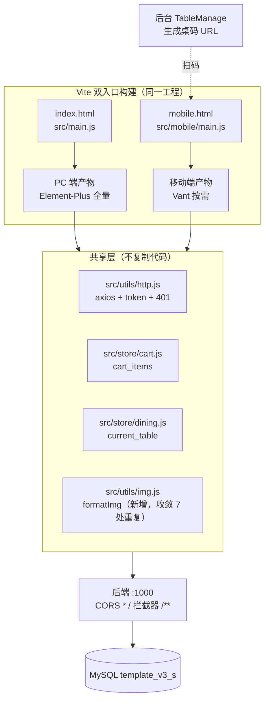
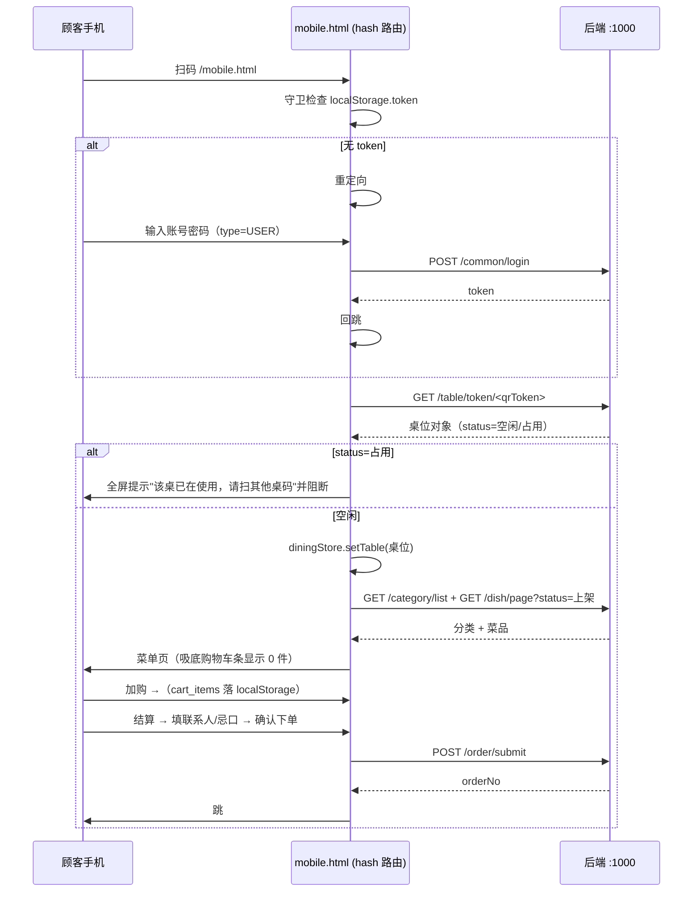

# 顾客端移动化改造 · 施工手册

> 版本：v1.0 · 2026-06-14
> 适用仓库：`template-v3-s`（半闲庭 · 高级餐厅点餐与管理系统）
> 本文性质：**施工手册**。只描述"要做什么、按什么顺序做、怎么判断做对了"，不代替你写业务代码。
> 本次交付只新增本文件，未修改仓库内任何既有代码或配置。

---

## 0. 怎么用这份手册

1. 先读 **第一章（现状诊断）**——那里列出了"手机打开为什么乱"的全部实证，以及若干会直接影响施工顺序的约束（最关键的一条：**未登录拉不到菜单**）。
2. 再读 **第三章（方案选型）**——本文推荐的不是"另起一个独立项目"，而是"同仓库双入口"。理由在那一章，读完你可以自己改判。
3. 然后**严格按第六章的 P0→P6 顺序施工**，每个阶段结束都有验收动作，不通过不进下一阶段。
4. 第七章给的是关键文件的骨架，照骨架写、不要照抄整段——填空的是你。
5. 第八章是坑表，遇到怪问题先查表。

---

## 一、现状诊断（全部结论带证据）

### 1.1 前端技术栈与入口（已核实）

| 项 | 事实 | 证据 |
|---|---|---|
| 框架 | Vue 3.4 + Vite 5 + vue-router 4（history 模式）+ Pinia 2 | `web\package.json` |
| UI 库 | Element-Plus 2.8 **全量**引入 + `@wocwin/t-ui-plus` 全量 + 全量图标注册 | `web\src\main.js`（25 行，`app.use(ElementPlus)`、循环注册 `ElementPlusIconsVue`） |
| 请求层 | axios 单实例，`baseURL = import.meta.env.VITE_APP_API_URL`，请求头塞 `token` | `web\src\utils\http.js:6`、`:18` |
| 状态 | Pinia：`cart`（`localStorage.cart_items`）、`dining`（`localStorage.current_table`） | `web\src\store\cart.js:6`、`web\src\store\dining.js:6` |
| 登录态 | `localStorage.token` + `localStorage.currentUser` | `web\src\utils\tools.js:7-12` |
| 入口 HTML | `web\index.html`，已含 `viewport width=device-width initial-scale=1.0` | `web\index.html:6` |
| 构建 | 单入口 `vite build --mode production` | `web\package.json` scripts |
| 测试 | **无任何测试文件**（`web\src` 下 `*.test.*` / `*.spec.*` / `__tests__` 计数为 0，已实测） | 环境注入的验证命令 pytest/mypy/ruff 与本项目无关，见 §11 |

路由拓扑（`web\src\router\index.js`）：

- `/` → `FrontLayout`：`index` / `menu` / `dishDetail/:id` / `cart` / `checkout` / `myOrders` / `reservation` / `about` / `myReservations` / `editCurrentUser` / `editPassword`
- `/admin` → `AdminLayout`：9 个管理页
- 独立页：`/login`、`/register`、`/retrievePassword`
- 全局守卫：无 `token` → `next({ path:'/login', query:{ redirect: to.fullPath } })`

### 1.2 手机端排版混乱的根因（逐页证据）

全仓库 `@media` 查询只有 **10 处**（逐文件实测：Login 1、NotFound 1、About 1、Cart 1、Checkout 1、MyOrders 1、MyReservations 1、Reservation 2、FrontLayout 1），而顾客端最核心的三个页面——`Menu.vue`、`index.vue`、`DishDetail.vue`——**计数为 0**：

| 页面 | 固定桌面宽度证据 | 有无移动断点 | 390px 视口下的后果 |
|---|---|---|---|
| `Menu.vue`（点餐主页面，最痛） | `.menu-container{display:flex;gap:60px;padding:0 40px}` `:144`；`.sidebar{width:200px;flex-shrink:0}` `:147`；`.dish-grid{repeat(3,1fr)}` `:161` | **无** | 390 − 80(左右 padding) − 200(侧栏) − 60(间距) = **50px 装 3 列卡片**，每列约 0px，必然横向溢出 + 卡片文字挤压 |
| `index.vue`（首页） | `.hero{height:85vh}` `:195`；`.hero-title{font-size:64px}` `:199`；`.dish-grid{repeat(3,1fr)}` `:218`；`.note-container{grid 1fr 1fr;gap:80px}` `:252`；`.section{padding:100px 0}` `:211`；`.cta-box{padding:100px 40px}` `:263` | **无** | 64px 标题在 390px 宽下每行只容 5~6 字；3 列卡片、双栏图文、100px 竖向留白全部溢出/被压扁 |
| `DishDetail.vue`（详情页） | `.detail-container{display:flex;gap:80px;padding:0 40px}` `:116`；`.image-wrapper{max-width:450px}` `:120`；`.title{font-size:48px}` `:127`；`.back-nav{position:absolute;left:40px}` `:151` | **无** | 左右分栏在手机上变成两列各占一半，圆形大图被压到 ~155px 且被 15px 边框吃掉；返回按钮 absolute 定位压住内容 |
| `FrontLayout.vue`（全局框架） | `.nav-container{max-width:1300px;height:80px;padding:0 40px}` `:125`；`.nav-links{gap:120px}` `:130`；`.footer-container{repeat(4,1fr)}` `:182` | 仅 footer 有 768px 断点 `:241` | 顶部导航 4 个链接 + 90px gap 直接横向溢出；导航 80px 高在手机上占 1/9 屏且无折叠菜单 |
| `AIAssistant.vue`（双端共用） | `.ai-btn{position:fixed;right:40px;bottom:40px;60×60}` `:109`；`.chat-window{position:fixed;right:40px;bottom:110px;width:350px;height:500px}` `:152` | **无** | 350 + 40 = 390px，正好等于视口宽度、**零余量**；iOS 带滚动条/安全区后必然溢出被裁切；500px 高的浮窗在 844px 高屏上压住半屏内容 |
| `Cart.vue` / `Checkout.vue` / `MyOrders.vue` / `Reservation.vue` / `MyReservations.vue` / `About.vue` | 均有 `max-width` + 768px 断点（如 `Cart.vue:94`、`Checkout.vue:135`、`MyOrders.vue:324`、`Reservation.vue:309`） | 有（粗粒度） | 不会溢出，但是"桌面布局缩小版"：字号 12~13px 偏小、点击区 <44px、无吸底操作条，可用但不好用 |

结论：**不是"某几处写错"，而是这批页面从未按移动视口设计过**。补齐 `@media` 可以止血，但会得到 9 个屏幕"缩小版茶餐厅 App"，与"高级餐厅"定位不符——这才是你要另做移动端的正当理由。

### 1.3 已有可复用资产（别重复造）

1. **移动端视觉稿已存在**：`docs\preview\src\04-front-mobile.html`（390px 桌码点餐稿），结构为「桌号头 → 分类 chips → 横向卡片列表 → 吸底结算条」，配套样式在 `docs\preview\src\style.css`（`.mobile` `.m-top` `.m-chips` `.m-item` `.m-bar` 等）。**移动端布局直接照这张稿落地**，不要重新设计。
2. **配色 token 已在代码里固化**：底 `#12100E`、卡片 `#1A1816`、主金 `#D5A958`（部分页面用 `#C6A15B`、`#D4AF37`，**不统一，见 §8 坑 A6**）、正文 `#F7F3EC`、次要 `#8B857C` / `#888`。
3. **图片域名修正逻辑**：数据库存的是 `http://localhost:1000/file/xxx`，各页面用 `formatImg(url)` 把 `localhost` 换成 `window.location.hostname` 才能在手机上出图。该函数在 **7 处重复**：`FrontLayout.vue:114`、`EditCurrentUser.vue:91`、`Cart.vue:62`、`Checkout.vue:91`、`DishDetail.vue:108`、`Menu.vue:81`、`index.vue:175`。
4. **桌码链路已通**：后台 `TableManage.vue` 的 `showQRCode()` 生成 `${window.location.origin}/index?table=${row.qrToken}`；前台 `index.vue` 读 `route.query.table` → `GET /table/token/{token}` → 状态为「占用」则弹窗阻断、空闲则写入 `diningStore`。
5. **登录回跳已做**：守卫把 `redirect` 塞进 query，`Login.vue` 登录后回跳。移动端守卫必须沿用同一套约定，否则扫完码登录完会掉回首页丢桌号。

### 1.4 后端契约（决定移动端能怎么接）

| 项 | 事实 | 证据 | 对移动端的含义 |
|---|---|---|---|
| 端口 | `server.port: 1000`，`server.ip: localhost` | `src\main\resources\application.yaml` | 手机访问要用 PC 的**局域网 IP:1000** |
| CORS | `allowedOriginPatterns("*")` + `allowCredentials(true)` + 全方法全头 | `config\CorsConfig.java:11-19` | **新前端换域名/端口也能直接调，后端零改动** ✅ |
| 鉴权 | 拦截器 `/**` 全拦，仅放行 `/common/login`、`/common/register`、`/common/retrievePassword`、`/file/**` | `config\SpringMvcConfig.java:16-25` | **未登录连 `/dish/page` 都调不到 → 扫码必须先登录**（§1.5 关键约束） |
| 登录 | `POST /common/login`，body 含 `username` / `password` / `type`（`USER` 或 `ADMIN`），header 回 `token` | `controller\CommonController.java`、`views\Login.vue` | 移动端登录必须显式传 `type: 'USER'` |
| 订单状态 | `已下单 → 制作中 → 已上菜 → 已完成`，另有 `已取消` | `views\front\MyOrders.vue:29-40`（el-steps 四步 + 取消分支） | 移动端时间轴直接映射这 5 个值 |
| 下单载荷 | `{orderType, contactName, contactTel, remark, tableId, items:[{dishId, quantity}]}` | `views\front\Checkout.vue` 的 `submitOrder()` | 直接复用，注意 `dishId` 与前端 `id` 的字段名差异 |
| 下单返回 | `ResponseVO.ok(orderNo)`（字符串单号） | `controller\OrderController.java` `/order/submit` | 成功后拿单号跳订单页，别指望返回订单 id |
| AI | `POST /ai/chat` body `{message, role, userId}`，**同步整段返回**（非流式） | `controller\AIController.java`、`components\AIAssistant.vue` | 移动端沿用同一接口；`role` 现在靠 `window.location.pathname.startsWith('/admin')` 判断，双入口后**这个判断会失效**（§8 坑 A3） |

顾客端可用接口清单（`controller\*Controller.java` 实测前缀）：

```
GET  /category/list                       分类列表
GET  /dish/page?pageNum&pageSize&status=上架&categoryId&isSignature
GET  /dish/selectById/{id}                菜品详情
GET  /table/token/{token}                 桌码换桌位
GET  /table/available?reserveDate&reserveTime&peopleCount
POST /order/submit                        下单（需 token）
GET  /order/myPage?pageNum&pageSize&status 我的订单（需 token）
GET  /order/detail/{orderNo}              订单详情（需 token）
GET  /reservation/my?pageNum&pageSize      我的预订（需 token）
POST /reservation/add                     新建预订（需 token）
POST /reservation/cancel/{id}             取消预订（需 token）
GET  /review/page                         评价列表
POST /review/add                          提交评价（需 token）
POST /common/login | register | retrievePassword
GET  /common/currentUser                  当前用户（需 token）
POST /ai/chat                             AI 对话（需 token）
GET  /file/{fileName}                     图片（免鉴权）
```

### 1.5 三条会改变施工顺序的硬约束

**约束 1：扫码 → 必须先登录 → 才能看到菜单。**
`SpringMvcConfig` 只放行 4 个路径，`/dish/page`、`/category/list`、`/table/token/{token}` 都在拦截范围内。当前 PC 端用户扫码的真实体验是：落地页被守卫踢到 `/login?redirect=/index?table=xxx` → 登录 → 回跳 → 才拿到桌号、拉到菜品。移动端必须**原样继承**这条链（含 `redirect` 带 query），否则桌号丢失。

> 若你希望"扫码先浏览菜单、下单才要求登录"，需要改后端白名单（放行 `GET /dish/**`、`GET /category/list`、`GET /table/token/**`）。这是**后端行为变更**，涉及安全边界，本手册不擅自纳入计划——列入 §11 待你决策项。

**约束 2：桌码 URL 是后台用 `window.location.origin` 现算的。**
换前端域名 → 后台 `showQRCode()` 生成的地址仍指向 PC 端。两种解法见 §6 P1 的"二维码兼容"，推荐先做 UA 分流（改 1 个文件），二维码改造放到 P5。

**约束 3：`localStorage` 是顾客端状态的唯一载体（token / currentUser / cart_items / current_table）。**
同源才能共享。**这一条直接决定了 §3 的方案取舍。**

---

## 二、目标与非目标

**目标**
1. 手机（375 / 390 / 430 宽）打开后，顾客链路 100% 可用：扫码落桌 → 登录 → 看菜单 → 加购 → 结算下单 → 查订单 → 订位 → 查预订。
2. 视觉延续暗金高级感，不是"缩小版桌面站"；核心操作（加购、结算）在拇指热区 + 吸底常驻。
3. PC 端一行不坏：现有路由、页面、后台管理全部保持原样。
4. 移动端首屏不加载 Element-Plus（弱网扫码场景，包体是体验的一部分）。

**非目标（本次不做）**
- 不重写后台管理端（`/admin/*` 保持桌面）。
- 不做小程序 / 公众号（扫码用浏览器 H5）。
- 不改数据库结构、不改既有接口签名。
- 不做 PWA 离线/推送（可留到答辩后的加分项）。

---

## 三、方案选型（先看结论，再看取舍）

### 3.1 三个候选

| # | 方案 | 形态 | 包体 | 状态共享 | 后台/二维码改动 | 部署 |
|---|---|---|---|---|---|---|
| **M1** | 现有工程内加 `/m/*` 路由 | 一份 `main.js`，两个 layout | ❌ 仍全量加载 Element-Plus（`main.js` 已 `app.use(ElementPlus)` 全量） | ✅ 同源同 app | 二维码改路径 | 零成本 |
| **M2**（推荐） | **同仓库双入口 + Vant**：`index.html` 与 `mobile.html` 各自 `main.js`，Vite `rollupOptions.input` 两页 | 两份产物，共享 `src/store`、`src/utils`、API 契约 | ✅ 移动端只带 Vant（按需） | ✅ 同源（同域不同路径）→ localStorage 天然共享 | 二维码改 URL，或用 UA 分流 | 零成本（同一 dist） |
| **M3** | 独立子项目 `web-mobile/`，独立端口/域名 | 完全新增 | ✅ 最干净 | ❌ **跨源，localStorage 不共享** → token/购物车/桌号要重新设计 | 二维码必须改域名 | 两个站点、两套构建 |

### 3.2 推荐 M2，理由（可反驳，逐条带依据）

1. **"全新另外的技术栈"里真正需要换的只有 UI 库，不是框架。**
   现有 Vue 3 + Vite + Pinia + axios + 路由守卫已覆盖移动端全部需求。换成 React/uni-app 会连带重写 `http.js` 的 401 处理、`router` 守卫、`cart` store —— 这三样正是扫码点餐最容易出 bug 的地方（桌号丢失、401 死循环）。收益为零，风险为正。
2. **需要换 UI 库，且有量化理由。**
   `web\src\main.js` 全量 `app.use(ElementPlus)` + 全量图标 + `@wocwin/t-ui-plus`，PC 端 31 个 .vue 文件共担这份体积是合理的；移动端只有 10 个页面却要背同样一份，弱网扫码首屏会明显吃亏。Vant 4 是 Vue 3 生态最成熟的移动组件库（Field/Popup/Tabbar/Stepper/SafeArea 都是移动原生语义），按需引入后移动端产物与 PC 端解耦。
   （包体具体差多少：**预期显著，本文未实测** —— 想量化就在 P0 阶段跑一次 `npm run build-prod` 记下当前 `dist/assets/*.js` 体积作为基线，改造后再比。）
3. **M2 保住了 M3 会打断的三条链路。**
   - 扫码落地：`${origin}/index?table=xxx` 与移动端同源 → `diningStore` 里的 `current_table` 不会被浏览器按 origin 隔离。
   - 加购 → 结算：`cart_items` 同一 key，同源共享；PC 上先加购、手机接着结账也能连续。
   - 401 处理：`http.js` 一处维护，不必在两个项目里各写一遍拦截器。
4. **M3 的真实成本（如果你仍想做 M3，先读这段）**：跨源后 `cart_items`/`current_table` 全部失效 → 扫码桌号必须靠 URL 参数在移动端重新注入（可解）；`token` 要在移动域重新登录（可解，但顾客会疑惑"我刚登录过"）；`http.js`、路由守卫、登录回跳逻辑要复制两份并保持同步（长期债务）；后台上生成的二维码必须改成移动域地址，PC 用户再扫就进不去桌面版。**答辩时"我们有三个前端"是加分也是自找麻烦。**

### 3.3 移动端路由模式：用 hash，不用 history

- PC 端现在是 `createWebHistory()`，部署在根，依赖服务器 rewrite。
- 移动端入口是文件 `mobile.html`，若用 history 模式，dev server 的 fallback 会回落到 `index.html`（PC 首页），一刷新/一分享就串台。
- 所以移动端用 **`createWebHashHistory()`**：URL 形如 `http://192.168.x.x:5173/mobile.html#/menu`。静态托管（nginx 指目录、GitHub Pages）无需任何 rewrite 规则，答辩现场用手机访问也不会 404。

---

## 四、目标架构

### 4.1 构建与运行时



### 4.2 顾客在手机上的实际时序（含约束 1 的登录夹层）



### 4.3 目录规划（新增为主，改动极少）

```
template-v3-s\
├── web\
│   ├── index.html                     ← 不动（PC 入口）
│   ├── mobile.html                    ← 新增（移动端入口，viewport-fit=cover）
│   ├── vite.config.js                 ← 改（加 build.rollupOptions.input 两页）
│   └── src\
│       ├── main.js                    ← 不动
│       ├── utils\
│       │   ├── http.js                ← 不动（被两个入口复用）
│       │   └── img.js                 ← 新增（收敛 formatImg，PC 端可选择性迁移）
│       ├── store\                     ← 不动（cart / dining 直接被移动端 import）
│       ├── styles\
│       │   ├── admin.css / front.css  ← 现状未被任何文件 import（见坑 A7），不碰
│       │   └── mobile.css             ← 新增（token + reset + 安全区 + 通用原子类）
│       └── mobile\
│           ├── main.js                ← 新增（Vant 按需 + pinia + mobile router）
│           ├── App.vue                ← 新增（<router-view/> + 全局样式引入）
│           ├── router\index.js        ← 新增（hash 模式 + 守卫 + redirect 回跳）
│           ├── layout\MLayout.vue     ← 新增（NavBar + 内容区 + Tabbar + 安全区）
│           ├── components\
│           │   ├── MTabbar.vue
│           │   ├── MDishCard.vue       ← 列表项（照 04-front-mobile.html 的 .m-item）
│           │   ├── MStepper.vue        ← 数量加减（44px 热区）
│           │   ├── MBottomBar.vue      ← 吸底结算条（.m-bar）
│           │   ├── MCategoryChips.vue  ← 横向分类（.m-chips）
│           │   ├── MEmpty.vue
│           │   └── MAssistant.vue      ← AI 管家移动版（全屏 sheet，替换 350px 定宽浮窗）
│           └── views\
│               ├── Index.vue           ← 扫码落地
│               ├── Menu.vue            ← 点餐主页面
│               ├── DishDetail.vue
│               ├── Cart.vue
│               ├── Checkout.vue
│               ├── Orders.vue
│               ├── Reservation.vue
│               ├── MyReservations.vue
│               ├── Me.vue
│               ├── Login.vue
│               ├── Register.vue
│               └── About.vue           ← P6 可选
```

移动端路由表（hash 内路径）：

```
/index            扫码落地（桌号识别 + 招牌菜）
/menu             点餐主页面（分类 chips + 列表 + 吸底条）
/dish/:id         菜品详情
/cart             购物车
/checkout         确认订单
/orders           我的订单
/reservation      在线订位
/myReservations   我的预订
/me               个人中心
/login /register /retrievePassword
/about            （可选）
```

底部 Tabbar 四格：**点餐 / 订单 / 订位 / 我的**。

---

## 五、移动端设计基线（写代码前先定这些，避免边写边改）

### 5.1 尺寸与栅格

| 项 | 取值 | 说明 |
|---|---|---|
| 设计基准 | 390 × 844（iPhone 14/15） | 兼顾 375（SE/13 mini）与 430（Pro Max） |
| 页面左右 padding | 16px | 列表卡片贴到 12px 视觉边距 |
| 最小点击区 | 44 × 44px | 加购按钮、步进器、Tabbar 项一律满足 |
| 字号阶梯 | 11 / 12 / 13 / 15 / 17 / 20 / 24 / 28 | 正文 15，次要 13，价格 20 |
| 卡片圆角 | 10~12px | 与 PC 端 `el-card` 的 10px 呼应 |
| 行高 | 正文 1.6 | 中文长描述 1.75 |
| 视口高度 | `100dvh`（不用 `100vh`） | iOS Safari 地址栏导致 `100vh` 跳动 |
| 安全区 | `padding-bottom: calc(12px + env(safe-area-inset-bottom))` | 吸底条 + Tabbar 必须加，否则 iPhone 底部被 Home 指示条压住 |

### 5.2 设计 token（`web\src\styles\mobile.css` 顶部，与 PC 端配色对齐）

```css
:root {
  --m-bg:        #12100E;   /* 页面底 */
  --m-surface:   #1A1816;   /* 卡片 */
  --m-surface-2: #2A2826;   /* 图片占位 / 输入框 */
  --m-gold:      #D5A958;   /* 主金 */
  --m-gold-dim:  rgba(213,169,88,.15);
  --m-text:      #F7F3EC;
  --m-text-2:    #A39F9A;
  --m-muted:     #8B857C;
  --m-danger:    #C0705C;
  --m-ok:        #67C23A;
  --m-radius:    12px;
  --m-gap:       16px;
  --m-tap:       44px;
}
```

> 注意：PC 端不同页面在混用 `#D5A958` / `#C6A15B` / `#D4AF37` 三个"金"（坑 A6）。移动端只认 `--m-gold`，不跟随混用。

### 5.3 Element-Plus → Vant 4 组件映射（不要用 Element 的移动姿态）

| 场景 | PC 现状（Element） | 移动端改用（Vant 4） | 理由 |
|---|---|---|---|
| 表单输入 | `el-input` / `el-form` | `van-field` + `van-form` | 移动端 label 在左会被键盘挤压，Vant 默认上下结构 |
| 数字步进 | 手写 `button` 对 | `van-stepper` | 内置 44px 热区与长按连加 |
| 弹窗 | `el-dialog` / `ElMessageBox` | `van-popup` / `van-dialog` | 移动端要底部弹出 + 遮罩点击关闭 |
| 列表空态 | `el-empty` | `van-empty` | 尺寸适配 |
| 分类切换 | `.category-item` 竖排 | `van-tabs` sticky 或自写 chips | 移动端用横向 chips（照 04-front-mobile.html） |
| 吸底操作 | 无（桌面无此概念） | `van-submit-bar` 或自写 `MBottomBar` | 拇指热区 |
| 骨架/加载 | `v-loading` | `van-skeleton` / `van-loading` | 弱网要骨架屏，不是转圈遮罩 |
| Toast | `ElMessage` | `showToast` / `showSuccessToast` | —— |

### 5.4 必须沿用的业务约定（改模块边界时不能忘）

- `http.js` 的 `baseURL = import.meta.env.VITE_APP_API_URL`：移动端同源，**沿用同一个实例，不要新建 axios**。
- 请求头字段名是 `token`（小写），不是 `Authorization`（`web\src\utils\http.js:18`）。
- 401 → 清 token → 跳登录（移动端要保证跳的是 `#/login` 而不是 PC 的 `/login`，见坑 A4）。
- 金额一律 `toFixed(2)`；下单 `items[].dishId` 由购物车的 `id` 映射而来。
- 装 `diningStore.currentTable` 前先判 `status === '占用'` 并阻断。

---

## 六、分阶段施工（P0 → P6）

> 原则：每个阶段结束时**PC 端必须仍然正常**。任何阶段发现 PC 回归，先回滚该阶段再继续。
> 每个阶段给了"新增/改动文件"和"验收动作"，验收不过不进下一阶段。

### P0 · 环境基线与备份（0.5 ~ 1 人时）

**做**
1. 确认 Node 版本 ≥ 18：`node -v`。
2. 确认后端能起：`mvn compile` 后 `mvn spring-boot:run`，浏览器访问 `http://localhost:1000/file/...` 任一图片能出。
3. 确认前端能起：`cd web && npm run dev`，PC 端 `http://localhost:5173` 正常。
4. **确认 API 地址**：打开 `web\.env.development` 看 `VITE_APP_API_URL` 的实际值（本次分析因安全策略未读取该文件，请你亲自核对是 `http://localhost:1000` 还是带 `/api` 前缀——**这决定后面所有接口能不能通**）。
5. 记录包体基线：`npm run build-prod`，把 `dist\assets\` 下最大的 `.js` 体积记在下面表格里（用于 §3.2 第 2 条的量化对比）。

   | 基线项 | 值 |
   |---|---|
   | 构建日期 | |
   | 最大 js 体积 | |
   | dist 总大小 | |

6. 备份：`git status` 确认工作区干净；确保本手册已提交（`git add docs` → commit），后续改动出问题可 `git reset` 回这里。

**验收**：PC 端全站点击一遍（首页/菜单/详情/购物车/结算/我的订单/订位），无报错。

---

### P1 · 双入口骨架（2 ~ 3 人时）

**改动**
1. `web\vite.config.js`：加 `build.rollupOptions.input`（骨架见 §7.1）。
2. 新增 `web\mobile.html`（骨架见 §7.2），必须含：
   - `<meta name="viewport" content="width=device-width, initial-scale=1.0, viewport-fit=cover, maximum-scale=1.0, user-scalable=no">`
   - `<title>半闲庭 · 点餐</title>`
   - `<script type="module" src="/src/mobile/main.js"></script>`
3. 新增 `web\src\mobile\main.js`、`App.vue`、`router\index.js`（骨架见 §7.3 / §7.4）。
4. 新增 `web\src\styles\mobile.css`（§5.2 的 token + reset：`*{box-sizing:border-box}`、`body{margin:0;background:var(--m-bg);color:var(--m-text);-webkit-font-smoothing:antialiased}`、`input{-webkit-appearance:none}`）。

**二维码兼容（二选一，推荐 A）**
- **A（推荐，改 1 处）**：`web\src\views\front\index.vue` 的 `onMounted` 最前面加 UA 分流——检测到移动 UA 且 `route.query.table` 存在时 `location.replace('/mobile.html#/index?table=' + token)` 并 `return`。好处：所有已印出去的二维码立刻可用，后台不动。
- **B（放 P5）**：改 `admin\TableManage.vue` 的 `showQRCode()`，`scanUrl` 从 `${origin}/index?table=` 改成 `${origin}/mobile.html#/index?table=`。好处：无需 UA 嗅探。坏处：老二维码指向 PC 端。

**验收**
- `npm run dev` 后访问 `http://localhost:5173/` → PC 首页正常。
- 访问 `http://localhost:5173/mobile.html` → 显示占位页（"移动端施工中"即可），**无白屏、无 console 报错**。
- `npm run build-prod` → `dist\` 下同时出现 `index.html` 与 `mobile.html`。
- 手机连同一 WiFi，访问 `http://<PC局域网IP>:5173/mobile.html` 能看到占位页（dev server 默认只监听 localhost 时，用 `npm run dev -- --host`）。

---

### P2 · 移动端基础层（4 ~ 6 人时，本阶段最容易翻车）

**做**
1. **布局壳 `MLayout.vue`**：NavBar（左返回/标题/右购物车角标）+ `<router-view/>` + `MTabbar`；内容区 `padding-bottom` 预留 Tabbar 高度 + 安全区。
2. **路由守卫**（照 §7.4 写），要点：
   - 白名单 `['/login','/register','/retrievePassword']`（**带前导斜杠**，PC 端 `router\index.js` 里的白名单漏了斜杠，见坑 A5）
   - 无 token → `next({ path:'/login', query:{ redirect: to.fullPath } })`
   - 登录成功后 `router.replace(redirect || '/index')`，**redirect 里必须保留 `?table=`**（§7.5）
3. **图片工具 `web\src\utils\img.js`**：把 7 处重复的 `formatImg` 收敛成一个函数并导出；移动端全部改用 `import { formatImg } from '@/utils/img'`。
4. **AI 管家 `MAssistant.vue`**：改成「右下角悬浮球（距底 `calc(16px + env(safe-area-inset-bottom))`）」+「全屏 `van-popup` position=bottom 的聊天面板」；沿用 `POST /ai/chat`；`role` 显式传 `'USER'`（不要靠 pathname 判断，见坑 A3）。
5. **登录页 `views/Login.vue`**（移动端那份）：`van-form` + `van-field`（`type=password`）+ 登录按钮 loading 态 + "没有账号？注册"。
6. **吸底条与吸底安全区**组件化，避免每个页面各写一遍。

**验收（真机，不要只在 DevTools 里看）**
- 手机浏览器打开 `#/menu`（未登录）→ 自动跳 `#/login?redirect=/menu` → 登录成功 → 回到 `#/menu`。
- 手机打开 `#/login?redirect=/index?table=XXX`（XXX 用后台"查看桌码"里真实的 qrToken）→ 登录 → 落回 `#/index?table=XXX` → Toast 显示桌号。
- 键盘弹起时输入框不被遮挡（iOS 重点测）。
- 页面底部内容不被 Home 指示条压住（iPhone 无 Home 键机型）。

---

### P3 · 点餐主链路（10 ~ 14 人时，工作量最大）

| 页面 | 关键要求 | 复用来源 |
|---|---|---|
| `Index.vue` 扫码落地 | 桌号卡（桌号 + 区域 + 人数）；招牌菜 3 个（`/dish/page?isSignature=1`）；"开始点餐"主按钮；占用桌位全屏阻断弹窗 | 逻辑照 `views\front\index.vue`（含 `route.query.table` → `/table/token/{token}` 全部分支） |
| `Menu.vue` 点餐页 | 顶部 sticky 分类 chips（横向滚动，`overflow-x:auto` + `scrollbar-width:none`）；列表项左图右文（图 88×88）；每项右侧 44px 加购按钮；**吸底条**显示「N 份 · ¥X / 去结算」，有商品时出现 | 视觉照 `docs\preview\src\04-front-mobile.html`；数据照 `views\front\Menu.vue` |
| `DishDetail.vue` | 大图铺满顶部（不用圆形裁切，手机圆形图浪费空间）；参数用分隔行；**吸底操作条**：步进器 + "加入点菜单 ¥X" | 数据照 `views\front\DishDetail.vue` |
| `Cart.vue` | 列表 + 每项步进器 + 左滑删除或显式删除按钮；吸底"去结算"常驻；空态引导回菜单 | store 照 `store\cart.js`（`incQuantity` / `decQuantity` / `removeItem` 直接用） |
| `Checkout.vue` | `van-form`：用餐方式（堂食/自取，堂食时锁死为桌号）、联系人、电话、忌口备注；合计；确认下单；**按钮 loading 防重复提交** | 载荷照 `views\front\Checkout.vue` 的 `submitOrder()` |
| `Orders.vue` 我的订单 | 卡片：单号 + 状态标签 + 菜品缩略 + 金额 + 时间；进度用 `van-steps` 映射 5 个状态；下拉刷新 | 照 `views\front\MyOrders.vue:29-46` |

**验收（这一阶段决定项目成败，逐条走）**
1. 手机上完整下单一次：扫码 → 登录 → 加 2 个菜 → 结算 → 提交。后端 `order` 表新增一条，`status='已下单'`，`tableId` 是扫码那张桌。
2. 后台 `OrderManage` 能看到该订单并可改状态；手机 `#/orders` 下拉刷新后状态同步变化。
3. 下单后购物车自动清空（`cartStore.clearCart()`），`localStorage.cart_items` 为 `[]`。
4. 重复点击"确认下单"只产生 1 条订单（防重复提交生效）。
5. 网络断了（飞行模式）：点加购仍成功（本地 store），提交时出现明确错误提示而非白屏。

---

### P4 · 辅助页（5 ~ 7 人时）

| 页面 | 要求 |
|---|---|
| `Reservation.vue` | 日期（`van-calendar`）、时段（午市/晚市 → 具体时间）、人数、姓名/电话；提交前调 `/table/available` 判断是否有空桌并提示 |
| `MyReservations.vue` | 列表 + 状态 + 取消（`POST /reservation/cancel/{id}`，需二次确认） |
| `Me.vue` | 头像/昵称、当前桌号、入口：我的订单/我的预订/个人信息/修改密码/退出登录 |
| `Register.vue` / `RetrievePassword.vue` | 复用 `/common/register`、`/common/retrievePassword` |
| `About.vue`（可选） | 品牌故事，照 `views\front\About.vue` 内容重排为单列 |

**验收**：每页在 375 / 390 / 430 三个宽度下无横向滚动条（`document.documentElement.scrollWidth === window.innerWidth`）；预订 → 后台 `ReservationManage` 能看到；取消 → 状态变 `已取消`。

---

### P5 · 打磨与兼容（4 ~ 6 人时）

1. **二维码正式切换**：`TableManage.vue` 的 `showQRCode()` 指向 `mobile.html#/index?table=`；同时保留 PC 端 UA 分流（P1-A）以兼容旧码。
2. **弱网**：菜品列表加骨架屏；图片 `loading="lazy"` + 占位底色；请求失败给"重试"按钮（`http.js` 已有网络异常提示，但需要页面内的可重试入口）。
3. **视觉一致性**：按 §5.1/§5.2 核对字阶、间距、金色（只用 `--m-gold`）。
4. **清理**：移动端代码里不留 `console.log`；不留临时 `alert`/`debugger`。
5. **后台保持不动**：确认 `/admin/*` 在手机上打开时**仍然是桌面版**（哪怕难用）——这是非目标，别顺手改。

**验收**：见 §9 完整清单。

---

### P6 · 答辩材料与文档（2 人时）

1. 在本手册末尾追加「实施记录」：每阶段实际耗时、遇到的问题、最终方案与原计划的偏差（答辩讲"取舍"比讲"功能"得分高）。
2. 截 3 张图：手机点餐页、手机订单页、后台接单页 → 存 `docs\preview\`。
3. 在 `docs\餐厅点餐系统-施工手册2.0.md` 的"下一步行动路线"里把移动端标记为已完成（**只改那一节，不要重写整份交接文档**）。

---

## 七、关键文件骨架（写代码时照这个填）

### 7.1 `web\vite.config.js`（改）

```js
import { fileURLToPath, URL } from 'node:url'
import { defineConfig } from 'vite'
import vue from '@vitejs/plugin-vue'
import vueJsx from '@vitejs/plugin-vue-jsx'
import Components from 'unplugin-vue-components/vite'
import { VantResolver } from '@vant/auto-import-resolver'

export default defineConfig({
  plugins: [
    vue(),
    vueJsx(),
    // 只对移动端入口做 Vant 按需；PC 端不受影响（PC 用的是 Element）
    Components({ resolvers: [VantResolver()], dts: false }),
  ],
  resolve: { alias: { '@': fileURLToPath(new URL('./src', import.meta.url)) } },
  build: {
    rollupOptions: {
      input: {
        main: fileURLToPath(new URL('./index.html', import.meta.url)),     // PC
        mobile: fileURLToPath(new URL('./mobile.html', import.meta.url)),  // 移动端
      },
    },
  },
})
```

需新增 devDependencies：`npm i vant` + `npm i -D unplugin-vue-components @vant/auto-import-resolver`。

> 若按需引入的插件配置让你觉得麻烦，退一步也可以 `import 'vant/lib/index.css'` 全量引样式、组件手动 `import { Field } from 'vant'`——能跑通优先，P5 再优化。

### 7.2 `web\mobile.html`（新增）

```html
<!DOCTYPE html>
<html lang="zh-CN">
<head>
  <meta charset="UTF-8" />
  <link rel="icon" type="image/svg+xml" href="/favicon.svg" />
  <meta name="viewport"
        content="width=device-width, initial-scale=1.0, viewport-fit=cover, maximum-scale=1.0, user-scalable=no" />
  <meta name="theme-color" content="#12100E" />
  <title>半闲庭 · 点餐</title>
</head>
<body>
  <div id="mobile-app"></div>
  <script type="module" src="/src/mobile/main.js"></script>
</body>
</html>
```

### 7.3 `web\src\mobile\main.js`（新增）

```js
import { createApp } from 'vue'
import { createPinia } from 'pinia'
import App from './App.vue'
import router from './router'
import '@/styles/mobile.css'

const app = createApp(App)
app.use(createPinia())   // 独立 pinia 实例，但 store 的 localStorage key 与 PC 共享
app.use(router)
app.mount('#mobile-app')
```

要点：
- **不要** `import ElementPlus`，也**不要** `import '@/main.js'`。
- `store/cart.js`、`store/dining.js`、`utils/http.js` 直接 import 复用（它们不依赖 UI 库）。

### 7.4 `web\src\mobile\router\index.js`（新增）

```js
import { createRouter, createWebHashHistory } from 'vue-router'
import MLayout from '@/mobile/layout/MLayout.vue'

const routes = [
  { path: '/', redirect: '/index' },
  { path: '/login',    component: () => import('@/mobile/views/Login.vue') },
  { path: '/register', component: () => import('@/mobile/views/Register.vue') },
  { path: '/retrievePassword', component: () => import('@/mobile/views/RetrievePassword.vue') },
  {
    path: '/', component: MLayout,
    children: [
      { path: 'index',          component: () => import('@/mobile/views/Index.vue') },
      { path: 'menu',           component: () => import('@/mobile/views/Menu.vue') },
      { path: 'dish/:id',       component: () => import('@/mobile/views/DishDetail.vue') },
      { path: 'cart',           component: () => import('@/mobile/views/Cart.vue') },
      { path: 'checkout',       component: () => import('@/mobile/views/Checkout.vue') },
      { path: 'orders',         component: () => import('@/mobile/views/Orders.vue') },
      { path: 'reservation',    component: () => import('@/mobile/views/Reservation.vue') },
      { path: 'myReservations',  component: () => import('@/mobile/views/MyReservations.vue') },
      { path: 'me',             component: () => import('@/mobile/views/Me.vue') },
      { path: 'about',          component: () => import('@/mobile/views/About.vue') },
    ],
  },
  { path: '/:pathMatch(.*)*', redirect: '/index' },
]

const router = createRouter({
  history: createWebHashHistory(),   // 关键：见 §3.3
  routes,
})

const WHITE = ['/login', '/register', '/retrievePassword']   // 前导斜杠不能漏（坑 A5）

router.beforeEach((to, from, next) => {
  document.title = to.meta.title ? `${to.meta.title} · 半闲庭` : '半闲庭 · 点餐'
  if (localStorage.getItem('token')) return next()
  if (WHITE.includes(to.path)) return next()
  next({ path: '/login', query: { redirect: to.fullPath } })   // fullPath 含 ?table=xxx
})

export default router
```

### 7.5 登录回跳（必须原样保留桌号参数）

```js
// views/Login.vue 里，登录成功后
const redirect = route.query.redirect
localStorage.setItem('token', res.data.token)
localStorage.setItem('currentUser', JSON.stringify(res.data.user))
router.replace(redirect || '/index')
```

`redirect` 里带着 `?table=<qrToken>`，回跳后 `Index.vue` 才能读到桌号。**这是整条链路唯一的"隐形契约"，改动前务必测一遍。**

### 7.6 `MLayout.vue` 骨架要点

```vue
<template>
  <div class="m-layout">
    <van-nav-bar :title="title" :left-arrow="showBack" @click-left="$router.back()" />
    <main class="m-main"><router-view /></main>
    <MTabbar />
    <MAssistant />
  </div>
</template>

<style scoped>
.m-layout { min-height: 100dvh; display: flex; flex-direction: column; background: var(--m-bg); }
.m-main {
  flex: 1;
  padding-bottom: calc(56px + env(safe-area-inset-bottom) + 8px); /* Tabbar + 安全区 */
}
</style>
```

### 7.7 吸底结算条 `MBottomBar.vue` 骨架要点

```vue
<template>
  <div class="m-bottom-bar">
    <div class="left">{{ totalCount }} 份 · <b>¥{{ totalAmount.toFixed(2) }}</b></div>
    <button class="go" @click="$emit('checkout')">去结算</button>
  </div>
</template>

<style scoped>
.m-bottom-bar {
  position: fixed; left: 0; right: 0; bottom: 0; z-index: 100;
  display: flex; align-items: center; justify-content: space-between;
  padding: 10px 16px calc(10px + env(safe-area-inset-bottom));
  background: var(--m-surface);
  border-top: 1px solid rgba(255,255,255,.06);
}
.go { min-width: 104px; height: 44px; background: var(--m-gold); color: #12100E; border: 0; border-radius: 22px; }
</style>
```

---

## 八、已知坑与对策（每条都有实证来源）

| # | 坑 | 症状 | 依据 | 对策 |
|---|---|---|---|---|
| A1 | **未登录拉不到任何菜品** | 扫码后一片空白 / 401 | `SpringMvcConfig.java:16-25` 只放行 4 个路径 | 移动端必须先登录再进菜单；不要把桌号存在登录前的 store 里（登录跳转会丢内存态，用 URL 参数带过去） |
| A2 | **图片在手机上裂开** | 图片全是 broken | 数据库存 `http://localhost:1000/...` | 一律走 `formatImg()`；移动端统一从 `@/utils/img` 引 |
| A3 | **AI 组件角色判断失效** | 移动端仍按 `ADMIN` 拉经营数据 | `AIAssistant.vue` 用 `window.location.pathname.startsWith('/admin')` 判断 | 移动端 `MAssistant` 显式传 `role: 'USER'`；PC 端那份不要动 |
| A4 | **401 跳到 PC 登录页** | 手机上点着点着进了 `/login`（PC 样式） | `http.js:35-38` 的 401 分支 `router.push("/login")`，用的是 **PC router 实例** | 移动端**不要直接改** `http.js`（会破坏 PC）；在移动端入口用拦截器或 `window.onunhandledrejection` 兜底；更干净的做法：`http.js` 导出的实例在移动端包一层 `mobileHttp` 适配器。见下方说明 |
| A5 | **PC 端白名单漏了斜杠** | 未登录访问 `/retrievePassword` 被踢到登录页 | `router\index.js` 里 `whiteList = ['/login','/register','retrievePassword']`，少了前导 `/` | 移动端守卫写对；PC 端这个问题**先记录不修**（不在本次范围，但可以写进答辩的"已知缺陷"） |
| A6 | **三个不同的"金"** | 页面之间金色不一致 | `#D5A958`（前台）、`#C6A15B`（后台/桌位）、`#D4AF37`（AI/页脚） | 移动端只用 `--m-gold: #D5A958` |
| A7 | **`front.css` 是死文件** | 改了 `front.css` 没反应 | `web\src\styles\front.css` **零引用**（`grep -rn "front\.css" src` 无匹配，实测）；而 `admin.css` 是被引用的——`AdminLayout.vue:120` 有 `import "@/styles/admin.css"`，只作用于后台 | 移动端样式放 `styles\mobile.css` 并在 `mobile/main.js` 里显式 import；不要指望全局自动生效 |
| A8 | **`100vh` 在 iOS 上跳动** | 吸底条在滚动时上下跳 | 移动 Safari 地址栏动态收缩 | 用 `100dvh`；吸底元素用 `position:fixed` + 安全区 padding |
| A9 | **AI 浮窗在手机上溢出** | 聊天窗右边缘被裁 | `.chat-window{right:40px;width:350px}`（`AIAssistant.vue:152`）+ 悬浮球 `:109`，390 视口零余量 | 移动端换成全屏 bottom popup（`MAssistant.vue`） |
| A10 | **手机访问不到 dev server** | 手机打开超时 | Vite 默认只听 localhost | `npm run dev -- --host`，用 PC 局域网 IP 访问；Windows 防火墙需放行 5173 |
| A11 | **二维码指向 localhost** | 手机扫码打不开 | `TableManage.vue` 的 `showQRCode()` 用 `window.location.origin`，且代码里已有 warning 提示 | 后台必须用局域网 IP 打开再生成二维码；或按 P5 改成可配置 base |
| A12 | **订单状态是中文硬编码** | 移动端若按英文枚举写会全空 | `MyOrders.vue:29-46` 用 `'已取消'`、`'已完成'` 中文字面量 | 移动端状态常量集中一个 `constants/order.js`，值必须与后端中文完全一致 |
| A13 | **`el-form` 的 `label-width` 在手机上挤压** | 输入框只剩一半宽 | `Checkout.vue` 用 `label-width="100px"` | 移动端用 `van-field` 上下结构，不用 label-width |
| A14 | **同一个 localStorage 被两个 app 同时写** | 手机下单后 PC 端购物车角标没变 | Pinia 只在当前 tab 内响应，`storage` 事件未监听 | 不算 bug，但要知情：跨端同步只在刷新后生效 |

**关于 A4 的推荐做法（移动端专属 http，而不改 PC 的）**

新建 `web\src\mobile\utils\http.js`：

```js
import http from '@/utils/http'   // 复用同一 axios 实例、同一拦截器
import mobileRouter from '@/mobile/router'

// 只覆盖 401 的跳转目标：PC 实例跳 /login（PC 路由），移动端要跳 #/login
// 做法一（推荐）：在移动端页面调用处 catch 401 自行处理
// 做法二：给 axios 实例挂一个可注入的 401 回调，PC/移动端各注册一个
export function setUnauthorizedHandler(fn) { /* 在 http.js 里留一个 hook */ }
```

如果不想动 `http.js`，最省事的兜底：移动端在每个 `request.*.catch()` 里判断 `error.response?.status === 401` → 清 token → `router.replace('/login')`。虽然重复，但零侵入。

---

## 九、完整验收清单（P5 结束时逐条打勾）

**环境**
- [ ] `npm run build-prod` 成功；`dist\` 下同时有 `index.html` 与 `mobile.html`
- [ ] PC 端 6 个主页面正常（首页/菜单/详情/购物车/结算/我的订单）
- [ ] `/admin/*` 全部正常，且手机上打开仍是桌面版

**移动端链路（真机，iOS + Android 各一）**
- [ ] 后台生成桌码 → 手机扫码 → 未登录 → 登录 → 落回带桌号的首页
- [ ] 桌位已占用时，扫码出现阻断提示且不写入桌号
- [ ] 菜单页分类切换正常，列表可滚动，无横向滚动条
- [ ] 加购 → 吸底条数字/金额实时变化
- [ ] 详情页步进器 +1/+N 后加入购物车数量正确
- [ ] 购物车增减/删除正确，金额 `toFixed(2)`
- [ ] 结算页表单校验（空手机号拦截），提交后 loading、成功跳订单页
- [ ] 订单页显示状态时间轴；后台改状态后下拉刷新能看到变化
- [ ] 订位提交成功，后台可见；取消后状态正确
- [ ] 个人信息页显示头像（图片走 `formatImg`，不是 broken）
- [ ] 退出登录后回到登录页，再进需要登录的页会被拦
- [ ] AI 管家弹出为全屏面板，输入框不被键盘遮挡，返回 `USER` 角色回答
- [ ] 全部页面：底部不被 Home 指示条压住；无横向溢出（`scrollWidth === innerWidth`）

**代码卫生**
- [ ] 移动端无 `console.log` / `debugger` / 临时 `alert`
- [ ] `formatImg` 在移动端只有一处实现（`@/utils/img`）
- [ ] 移动端没有 `import ElementPlus`
- [ ] `web\src\mobile\**` 之外只改了 `vite.config.js`（+ 可选的 `index.vue` UA 分流、`TableManage.vue` 二维码）

---

## 十、风险与回滚

| 风险 | 概率 | 影响 | 规避/回滚 |
|---|---|---|---|
| 双入口配置写错导致 PC 端构建失败 | 低 | 高 | P1 结束立刻验 PC 端 + build；失败只回滚 `vite.config.js` |
| Vant 按需插件与 Vite 5 版本不兼容 | 中 | 中 | 退化为手动 `import` + 全量 css（§7.1 备注） |
| 登录回跳丢桌号 | 中 | 高 | P2 验收里专门有一条；日志里打印 `redirect` 原值核对 |
| 401 把用户踢到 PC 登录页 | 中 | 中 | §8 A4 两个方案，先上兜底方案 |
| 手机访问不到后端（CORS/IP/防火墙） | 中 | 高 | 先用浏览器直接访问 `http://<IP>:1000/file/...` 验证网络层，再验接口 |
| 二维码已印出去、改了路径导致旧码失效 | 低 | 中 | 保留 P1-A 的 UA 分流，旧码仍可用 |
| 工期超预期 | 中 | 中 | P3 是主战场，P4/P6 可裁剪（About 页可删、答辩前只保底 4 个辅助页） |

**回滚粒度**：本方案的新增文件全部集中在 `web\src\mobile\**`、`web\mobile.html`、`web\src\styles\mobile.css`、`web\src\utils\img.js`。删除这些 + 还原 `vite.config.js` 即完全回到改造前，PC 端不受任何影响。

---

## 十一、本文未核实项 / 需要你确认的事

1. **`VITE_APP_API_URL` 的实际值未读取**（`web\.env.development` 命中安全策略）。请自行打开确认是否带 `/api` 前缀——若是，则 P2 起的接口路径要相应调整。
2. **移动端包体收益未实测**：§3.2 说"Vant 按需明显小于 Element 全量"是工程共识判断，具体差多少请在 P0 记基线、P5 再对比。
3. **未在真实移动视口截图验证**：本环境的分析基于静态样式证据（固定宽度、缺失的 media query）。§1.2 的"390px 下每列约 0px"是按 `Menu.vue` 的 `padding/gap/width` 推算，建议你 P0 用手机或 DevTools 390×844 截一张现状图存档，作为改造前后对比素材。
4. **后端白名单是否放开读接口**（§1.5 约束 1）：若你希望"扫码可先看菜单"，需要改 `SpringMvcConfig` 放行 `GET /dish/**`、`GET /category/list`、`GET /table/token/**`。这是安全边界变更，需你明确决定后另开一个小任务做，本手册不包含。
5. **仓库无测试框架**：环境注入的验证命令（`pytest / mypy / ruff`）与 Java + Vue 技术栈不符，且仓库根下并不存在 `.rivet-config.json`（`cat` 实测 No such file），属配置失真。本手册的验证均为"构建 + 真机手工验收"，如果你后续要补自动化，建议先在 `web\` 里引 Vitest 对 `store/cart.js`、`utils/img.js` 写单测（这两处是纯逻辑，最容易写也最容易回归）。

---

## 附：阶段工时汇总（供排期，按"你亲手写"估算）

| 阶段 | 内容 | 工时 | 可否裁剪 |
|---|---|---|---|
| P0 | 环境基线与备份 | 0.5 ~ 1 h | 不可 |
| P1 | 双入口骨架 + 二维码兼容 | 2 ~ 3 h | 不可 |
| P2 | 基础层（布局/守卫/登录/图片/AI） | 4 ~ 6 h | 不可 |
| P3 | 点餐主链路 6 页 | 10 ~ 14 h | 不可 |
| P4 | 辅助页 5 页 | 5 ~ 7 h | About 可删 |
| P5 | 打磨与兼容 | 4 ~ 6 h | 可压到 2 h（保底只做安全区 + 弱网重试） |
| P6 | 答辩材料 | 2 h | 可后置 |
| **合计** | | **28 ~ 39 h**（约 4~5 个工作日） | |

> 工时是给你的排期参照，不是承诺。P3 的实际耗时取决于你对 Vant 表单/弹窗的熟悉程度——第一次写建议先花 1 小时只做 `Menu.vue` 一页并跑通加购，再接其余页面。
