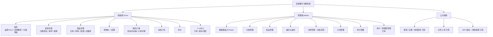
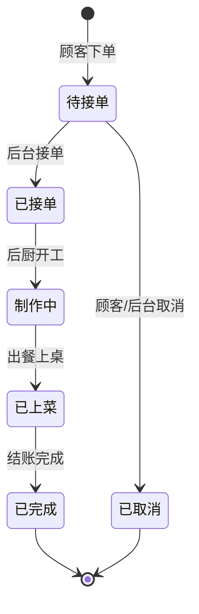

# 高级餐厅点餐系统 · 施工手册

> 用途：把当前脚手架（template-v3-s）改造成一套可答辩的高级餐厅点餐系统。
> 读者：由你本人按本文逐条动手写代码；本文只给**路线、契约、步骤、验收点和坑**，不给可直接粘贴的业务实现。
> 更新时间：基于对工作区 47 个文件的实际通读。

---


## 一、现状体检（先看清你手里有什么）

### 1.1 技术栈（实测）

| 层 | 技术 | 版本 | 证据 |
|---|---|---|---|
| 后端框架 | Spring Boot | 3.2.10（Java 17） | `pom.xml` parent |
| 持久层 | MyBatis（XML Mapper） | 3.0.4 | `pom.xml`、`src\main\resources\mapper\*.xml` |
| 数据库 | MySQL | 8.0.32，库名 `templatev3_s` | `application.yaml`、`sql\templatev3_s.sql` 头注释 |
| 鉴权 | JWT（jjwt 0.9.1）+ ThreadLocal + 拦截器 | — | `utils\JwtUtils.java`、`interceptor\LoginInterceptor.java` |
| 工具 | Lombok / fastjson2 / hutool / commons-io | — | `pom.xml` |
| 前端 | Vue 3.4 + Vite 5 + Element Plus 2.8 | — | `web\package.json` |
| 前端状态 | pinia（**已注册，但全项目零 store**） | 2.2.2 | `web\src\main.js:2,21` 已 `app.use(createPinia())`；全局 grep 无 `defineStore` |
| 前端可视化 | echarts（**已装未用**）、swiper（**已装未用**） | 5.5 / 11.1 | 同上 |
| 二维码 | qrcode（**已装未用**） | 1.5.3 | 同上 |
| 其它已装未用 | dayjs、lodash、crypto-js、sm-crypto、lunar-javascript、wangeditor、v-md-editor | — | 同上 |

**这里有个好消息**：`echarts`、`swiper`、`qrcode` 三个包恰好是"高级感"三件套（数据看板 / 轮播 / 桌码），依赖已经在 `package.json` 里了，你不需要再装东西。

**接口约定**：后端 `http://localhost:1000`，统一响应 `{code:200, msg:"操作成功", data:...}`（`vo\ResponseVO.java`），分页返回 `{list, total}`（`vo\PageVO.java`）；前端 `axios` 实例在 `web\src\utils\http.js`，baseURL 取 `import.meta.env.VITE_APP_API_URL`，请求头带 `token`。

### 1.2 已经能用的能力（可直接复用的资产）

| 能力 | 前端 | 后端 | 说明 |
|---|---|---|---|
| 登录（双角色） | `views\Login.vue` | `CommonController.login` | 角色 `ADMIN` / `USER`，登录后 token + currentUser 存 localStorage |
| 注册 / 找回密码 / 重置密码 | `Register.vue`、`RetrievePassword.vue` | `CommonController` | 找回密码未接验证码（源码 TODO） |
| 个人信息 / 改密 | `EditCurrentUser.vue`、`EditPassword.vue` | `CommonController.updateCurrentUser/updatePassword` | — |
| 通用 CRUD 范式（**最重要**） | `views\admin\UserManage.vue`（359 行） | `AdminController` + `AdminServiceImpl` + `AdminMapper.xml` | 搜索区 + 表格 + 分页 + 新增/编辑弹窗 + 批量删除，全套齐 |
| 图片上传 | `components\MyUpload.vue` | `FilesController` + `FileServiceImpl` | 文件落 `uploads\`，访问 `http://localhost:1000/file/xxx.png` |
| 富文本 | `components\MyEditor.vue` | — | 可用于菜品图文详情 |
| 分页 / 统一响应 / 全局异常 | — | `PageVO`、`ResponseVO`、`GlobalExceptionHandler` | — |
| 跨域 | — | `config\CorsConfig.java` | 全放开 `*` |

### 1.3 三个必须先知道的事实

**事实 1：SQL 脚本与真实数据库不一致——脚本只有 `admin` 一张表，库里却有 `user` 表。**
`sql\templatev3_s.sql` 共 42 行，只有 1 处 `CREATE TABLE`（`admin`）+ 1 条 `INSERT`（实测 `grep -n "CREATE TABLE"` 仅 24 行一处）。但 `src\main\resources\mapper\UserMapper.xml` 的增删改查全部操作 `user` 表。
实测本机数据库（`mysql -uroot -p123456` 连 `templatev3_s`）：实际存在 `admin`、`user` 两张表，`user` 表已有 6 条记录。
→ 所以**本机 USER 现在也能登录**（密码对得上就行）；真正的风险是**脚本不完整**：重建库、换机器、交论文时按脚本执行会缺 `user` 表，用户登录直接 500。
→ 第一件事：把 `user` 表 DDL 补进脚本（见 §2.4），让脚本与真实库对齐。

**事实 2：路由守卫是空壳，未登录也能先把后台框架渲染出来。**
`web\src\router\index.js:104-106` 的 `beforeEach` 里只有 `next()`，没有任何 token 判断。接口层有 `LoginInterceptor` 兜底返回 401，但页面会先闪一下再被踢走。
→ M0 顺手补：`beforeEach` 里判断 `localStorage.getItem('token')`，未登录且目标不是 `/login`、`/register`、`/retrievePassword` 时 `next('/login')`。
（另：已核对 `router\index.js:22` 引用的 `views/front/index.vue` 与磁盘文件名**大小写一致**，不存在路由大小写问题。）

**事实 3：图 2 的能力在当前工作区并不存在。**
图 2 的 URL 是 `/admin/productOrder`，页面有店铺、商品订单、收货人、骑手信息。而当前仓库：`controller` 只有 Admin / Common / Files / User 四个，`entity` 只有 Admin / User 两个，`router\index.js` 里没有任何 `productOrder` 或商品路由，`target\classes` 里也没有 Product / Order 的编译产物。
→ 结论：**图 2 是另一份项目的截图（外卖式的"多店铺点餐"），不是本仓库的成果**。本仓库目前 = 登录 + 用户管理脚手架。图 2、图 3 要表达的能力，都得从零在这里落地。
→ 这也意味着别去继承它的表结构（店铺 / 骑手 / 收货地址那套是外卖逻辑），高级餐厅要的是另一套模型（见 §2.4）。

**事实 4：本机还有一套"外卖式点餐"的旧库 `db_dingcan`——可以看，不要接。**
实测该库有 8 张表：`t_admin / t_catelog / t_goods / t_liuyan / t_order / t_orderitem / t_user / t_xinyong`，`t_goods` 有 5 条数据。字段是拼音命名（`bianhao / mingcheng / jieshao / shichangjia / tejia`）、主键 `varchar(50)`、逻辑删除 `del`、`t_order` 只有 `songhuodizhi`（送货地址）与 `fukuanfangshi`（付款方式）——典型的 JSP 毕设模板产物：纯外卖逻辑，没有分类排序、库存、图文详情、订位、评价。
→ 它很可能就是图 2 / 图 3 那套系统的库。可以借它参考"表怎么划分"，但**别把表搬进 `templatev3_s`**：拼音字段名会废掉 MyBatis 驼峰映射，`varchar` 主键与现有 `Integer id` 范式冲突，且缺库存/状态机字段。
→ 结论：按 §2.4 的 DDL 重新建，比改造旧库快得多。

### 1.4 现有代码里的真实隐患（改到相关文件时一并处理）

| 隐患 | 位置 | 后果 |
|---|---|---|
| 401 拦截未判空 | `web\src\utils\http.js` 响应拦截器 `switch (error.response.status)` | 网络断开/后端未启动时 `error.response` 为 undefined，直接抛 TypeError，控制台一堆红，看不到真正原因 |
| 路由守卫形同虚设 | `web\src\router\index.js` 末尾 `router.beforeEach((to,from,next)=>{next()})` | 未登录可直接敲 `/admin` 进后台框架（接口层有拦截，但页面会先渲染出来） |
| 登录跳转逻辑散落在布局组件内 | `FrontLayout.vue` / `AdminLayout.vue` 的 `setup` 顶层 `router.push` | 组件渲染期导航，偶发白屏；且刷新后 `currentUser` 从 localStorage 读，改密后不刷新 |
| 密码明文 | `Admin` / `User` 实体、`ServiceImpl.login` 直接 `equals` | 毕设可接受，但答辩会被问；可加 BCrypt（见 §6.3） |
| `console.log` 残留 | `router\index.js`、`http.js`、`FrontLayout.vue` | 留一两个无妨，但演示时 F12 一片日志不体面 |
| 无 `.env` 校验 | `web\.env.development`（内容需自检） | 确认里面是 `VITE_APP_API_URL=http://localhost:1000`，否则所有请求 404 |

---

## 二、目标蓝图（做成什么样子）

### 2.1 定位：不是外卖平台，是"堂食扫码点餐 + 在线订位"的高级餐厅

外卖式点餐（图 2/图 3 的形态）的关键词是：店铺、骑手、收货地址、满减。这套东西和"高级餐厅"是两种气质。高级餐厅的链路是：

```
到店/预订 → 落座 → 扫码看菜单 → 点菜（可加酒水搭配） → 下单 → 后厨制作 → 上菜 → 用餐 → 结账 → 评价
```

毕设不需要全做完，但**主线必须完整**：浏览菜品 → 加购物车 → 下单 → 查看订单状态 → 后台接单并推进状态。这条线通了，系统就成立；桌位二维码和在线订位是"高级感"的差异化加分项。

### 2.2 角色与用例

| 角色 | 能做什么 |
|---|---|
| 游客 | 浏览首页、菜单、菜品详情；注册 / 登录 |
| 顾客 USER | 购物车、下单（堂食/自取）、我的订单（状态时间轴）、在线订位、评价、个人中心 |
| 管理员 ADMIN | 菜品与分类管理、桌位与桌码管理、订单管理与状态流转、订位审核、评价回复、营业数据看板、用户/管理员管理（已有） |
| 服务员 WAITER（可选加分） | 只读订单看板 + 推进"已上菜"状态 |

### 2.3 功能地图



### 2.4 数据模型（7 张新表）

> 这是"数据契约"——**先按这个建表，再照表写代码**，能避免边写边改字段。字段中文注释写在 DDL 里，答辩时你要能逐个解释。

```sql
-- 1. 菜品分类
CREATE TABLE `category` (
  `id`        int NOT NULL AUTO_INCREMENT COMMENT '主键',
  `name`      varchar(50)  NOT NULL COMMENT '分类名（前菜/主菜/汤品/甜点/酒水）',
  `name_en`   varchar(80)  DEFAULT NULL COMMENT '英文名（排版用）',
  `sort`      int DEFAULT 0 COMMENT '排序，越小越靠前',
  `status`    varchar(20) DEFAULT '启用' COMMENT '启用/禁用',
  `create_time` timestamp DEFAULT CURRENT_TIMESTAMP,
  PRIMARY KEY (`id`)
) ENGINE=InnoDB DEFAULT CHARSET=utf8mb4 COMMENT='菜品分类';

-- 2. 菜品
CREATE TABLE `dish` (
  `id`          int NOT NULL AUTO_INCREMENT,
  `category_id` int NOT NULL COMMENT '所属分类',
  `name`        varchar(80)  NOT NULL COMMENT '菜名',
  `name_en`     varchar(120) DEFAULT NULL COMMENT '英文名',
  `cover_url`   varchar(255) NOT NULL COMMENT '主图（富文本详情另存 detail）',
  `detail`      text COMMENT '图文详情（富文本 HTML）',
  `description` varchar(255) DEFAULT NULL COMMENT '一句话风味描述',
  `ingredients` varchar(255) DEFAULT NULL COMMENT '主要食材',
  `spicy_level` tinyint DEFAULT 0 COMMENT '辣度 0-3',
  `pairing`     varchar(120) DEFAULT NULL COMMENT '推荐配酒/配茶',
  `price`       decimal(10,2) NOT NULL COMMENT '单价',
  `stock`       int DEFAULT 999 COMMENT '可售份数',
  `sales`       int DEFAULT 0 COMMENT '累计销量（下单+1）',
  `is_signature` tinyint DEFAULT 0 COMMENT '是否招牌',
  `is_recommend` tinyint DEFAULT 0 COMMENT '是否主厨推荐',
  `sort`        int DEFAULT 0,
  `status`      varchar(20) DEFAULT '上架' COMMENT '上架/下架',
  `create_time` timestamp DEFAULT CURRENT_TIMESTAMP,
  PRIMARY KEY (`id`),
  KEY `idx_cat` (`category_id`)
) ENGINE=InnoDB DEFAULT CHARSET=utf8mb4 COMMENT='菜品';

-- 3. 桌位
CREATE TABLE `dining_table` (
  `id`        int NOT NULL AUTO_INCREMENT,
  `table_no`  varchar(20) NOT NULL COMMENT '桌号，如 A01 / VIP-1',
  `area`      varchar(20) DEFAULT '大厅' COMMENT '大厅/包厢/露台',
  `capacity`  int DEFAULT 2 COMMENT '可容纳人数',
  `qr_token`  varchar(64) NOT NULL COMMENT '桌码唯一标识（写进二维码 URL）',
  `status`    varchar(20) DEFAULT '空闲' COMMENT '空闲/占用/预留',
  PRIMARY KEY (`id`),
  UNIQUE KEY `uk_qr` (`qr_token`)
) ENGINE=InnoDB DEFAULT CHARSET=utf8mb4 COMMENT='桌位';

-- 4. 订单
CREATE TABLE `orders` (
  `id`          int NOT NULL AUTO_INCREMENT,
  `order_no`    varchar(32) NOT NULL COMMENT '业务单号，如 OD20250628120001',
  `user_id`     int NOT NULL,
  `order_type`  varchar(20) NOT NULL DEFAULT '堂食' COMMENT '堂食/自取/预订',
  `table_id`    int DEFAULT NULL COMMENT '堂食时的桌位',
  `people_count` int DEFAULT 1 COMMENT '用餐人数',
  `total_amount` decimal(10,2) NOT NULL COMMENT '合计金额',
  `status`      varchar(20) NOT NULL DEFAULT '待接单' COMMENT '见状态机',
  `pay_status`  varchar(20) DEFAULT '未支付' COMMENT '未支付/已支付',
  `contact_name` varchar(50) DEFAULT NULL,
  `contact_tel`  varchar(20) DEFAULT NULL,
  `remark`      varchar(255) DEFAULT NULL COMMENT '忌口/备注',
  `create_time` timestamp DEFAULT CURRENT_TIMESTAMP,
  `update_time` timestamp DEFAULT CURRENT_TIMESTAMP ON UPDATE CURRENT_TIMESTAMP,
  PRIMARY KEY (`id`),
  UNIQUE KEY `uk_no` (`order_no`),
  KEY `idx_user` (`user_id`),
  KEY `idx_status` (`status`)
) ENGINE=InnoDB DEFAULT CHARSET=utf8mb4 COMMENT='订单';

-- 5. 订单明细（下单时快照菜名/价格，避免菜品改名改价影响历史订单）
CREATE TABLE `order_item` (
  `id`        int NOT NULL AUTO_INCREMENT,
  `order_id`  int NOT NULL,
  `dish_id`   int NOT NULL,
  `dish_name` varchar(80) NOT NULL COMMENT '下单时菜名快照',
  `cover_url` varchar(255) DEFAULT NULL,
  `price`     decimal(10,2) NOT NULL COMMENT '下单时单价快照',
  `quantity`  int NOT NULL,
  `subtotal`  decimal(10,2) NOT NULL COMMENT 'price * quantity',
  PRIMARY KEY (`id`),
  KEY `idx_order` (`order_id`)
) ENGINE=InnoDB DEFAULT CHARSET=utf8mb4 COMMENT='订单明细';

-- 6. 订位
CREATE TABLE `reservation` (
  `id`          int NOT NULL AUTO_INCREMENT,
  `user_id`     int NOT NULL,
  `table_id`    int DEFAULT NULL COMMENT '指定桌位，可空=系统安排',
  `reserve_date` date NOT NULL,
  `reserve_time` time NOT NULL,
  `people_count` int NOT NULL,
  `contact_name` varchar(50) NOT NULL,
  `contact_tel`  varchar(20) NOT NULL,
  `remark`      varchar(255) DEFAULT NULL,
  `status`      varchar(20) DEFAULT '待确认' COMMENT '待确认/已确认/已到店/已取消',
  `create_time` timestamp DEFAULT CURRENT_TIMESTAMP,
  PRIMARY KEY (`id`),
  KEY `idx_user` (`user_id`)
) ENGINE=InnoDB DEFAULT CHARSET=utf8mb4 COMMENT='在线订位';

-- 7. 评价
CREATE TABLE `review` (
  `id`        int NOT NULL AUTO_INCREMENT,
  `order_id`  int NOT NULL,
  `user_id`   int NOT NULL,
  `score`     tinyint NOT NULL COMMENT '1-5 星',
  `content`   varchar(500) DEFAULT NULL,
  `images`    varchar(1000) DEFAULT NULL COMMENT '多图，逗号分隔 URL',
  `reply`     varchar(500) DEFAULT NULL COMMENT '商家回复',
  `create_time` timestamp DEFAULT CURRENT_TIMESTAMP,
  PRIMARY KEY (`id`),
  UNIQUE KEY `uk_order` (`order_id`)
) ENGINE=InnoDB DEFAULT CHARSET=utf8mb4 COMMENT='订单评价';
```

补 `user` 表（照 `Admin` 表结构 + 会员字段）：

```sql
CREATE TABLE `user` (
  `id` int NOT NULL AUTO_INCREMENT,
  `username` varchar(255) DEFAULT NULL,
  `password` varchar(25)  DEFAULT NULL,
  `nickname` varchar(255) DEFAULT NULL,
  `avatar_url` varchar(255) DEFAULT NULL,
  `tel` varchar(255) DEFAULT NULL,
  `email` varchar(255) DEFAULT NULL,
  `status` varchar(128) DEFAULT '启用',
  `points` int DEFAULT 0 COMMENT '积分（消费 1 元 = 1 分）',
  `create_time` timestamp DEFAULT CURRENT_TIMESTAMP,
  PRIMARY KEY (`id`),
  UNIQUE KEY `uk_username` (`username`)
) ENGINE=InnoDB DEFAULT CHARSET=utf8mb4;
```

### 2.5 订单状态机（后台"推进状态"就靠它）



规则：
- 状态流转只允许**向前一步**或"取消"，后端必须校验（`if (!ALLOW.get(cur).contains(next)) throw new CustomException("状态流转非法")`），前端只显示合法按钮。
- 取消只允许 `待接单` / `已接单` 两个状态；取消时回滚 `dish.stock` 与 `sales`。
- 下单时在一个 `@Transactional` 方法里同时写 `orders` + `order_item` + 扣 `stock` + 加 `sales`。

### 2.6 接口清单（照现有风格：模块名做前缀）

| 模块 | 接口 | 说明 |
|---|---|---|
| 分类 | `GET /category/list`、`GET /category/page`、`POST /category/add`、`PUT /category/update`、`DELETE /category/delBatch` | 照 `AdminController` 抄 |
| 菜品 | `GET /dish/page`、`GET /dish/selectById/{id}`、`POST /dish/add`、`PUT /dish/update`、`DELETE /dish/delBatch` | 同上 |
| 前台菜品 | `GET /dish/front/list?categoryId=&keyword=&sort=`、`GET /dish/front/hot`、`GET /dish/front/signature` | 只返回上架菜品，含分类名（联表或二次查） |
| 订单 | `POST /order/submit`（body: 明细数组 + 类型 + 桌位）、`GET /order/myPage`、`GET /order/detail/{id}`、`GET /order/page`（后台）、`POST /order/updateStatus`、`POST /order/cancel/{id}` | `submit` 是唯一需要事务的接口 |
| 桌位 | `GET /table/list`、`POST /table/add`、`PUT /table/update`、`DELETE /table/delBatch`、`GET /table/qr/{id}`（返回二维码 base64 或 URL） | 二维码用 `qrcode` 包在前端生成更简单 |
| 订位 | `POST /reservation/add`、`GET /reservation/myPage`、`GET /reservation/page`、`POST /reservation/updateStatus` | — |
| 评价 | `POST /review/add`、`GET /review/page`、`GET /review/dish/{dishId}`、`POST /review/reply` | — |
| 看板 | `GET /stat/overview`（今日订单数/营业额/热销 Top5/近 7 日趋势）、`GET /stat/categoryRatio` | 一次返回多个数组，前端 echarts 直接吃 |

> SQL 统计接口不需要新表，直接用 `SELECT DATE(create_time) d, SUM(total_amount) FROM orders WHERE status='已完成' GROUP BY d` 这类聚合。

---

## 三、施工路线（分 4 阶段 9 个里程碑）

时间按"每天 3-4 小时"估。别跳阶段——每个里程碑的产出都是下一个的地基。

```
阶段一 · 地基（M0-M1）      阶段二 · 门面（M2）
阶段三 · 交易（M3-M4）      阶段四 · 差异化与打磨（M5-M8）
```

### M0 地基修复（0.5-1 天，先做这个）

**目标**：数据库和管理员/用户双角色登录全部打通，前端能同时进前台和后台。

步骤：
1. 在 Navicat 里执行 §2.4 的 `user` 表 DDL（`sql\templatev3_s.sql` 里同步补上）。
2. 手动插一条测试用户：`INSERT INTO user(username,password,nickname,status) VALUES('user1','123456','林小满','启用');`
3. 确认 `web\.env.development` 里是 `VITE_APP_API_URL=http://localhost:1000`。
4. 补路由守卫：`web\src\router\index.js:104` 的 `beforeEach` 现在只有 `next()`，改成判断 token，未登录且目标不是登录/注册/找回密码就跳 `/login`。
5. 建主题：按 §6.2 新建 `web\src\styles\theme.css`，在 `main.js` 里 import（放 Element Plus 之后），`AdminLayout.vue` 外层加 `admin-scope` 类。**现在做，省得后面每写一页都返工换色。**
6. `git init` 一次——这个目录现在不是 git 仓库，改崩了没有回退点。
7. 后端 `mvn spring-boot:run`，前端 `cd web && npm run dev`。

**验收（必须逐条看到）**：
- [ ] 用 `admin/123456` 登录 → 进 `/admin`，侧边栏有"管理员管理""普通用户"，用户列表能查出你刚插的 user1
- [ ] 用 `user1/123456` 登录 → 进 `/`，顶部显示头像和昵称，`/admin` 敲地址会被弹回前台
- [ ] F12 Network 里 `/common/login` 返回 `code:200` 且 data 是一段 JWT
- [ ] 主题生效：登录页按钮是香槟金 `#C6A15B`、卡片是深色；后台表格表头不再是默认蓝

> 卡住时先看浏览器 Console 第一条报错，再看后端控制台 MyBatis 打印的 SQL（`application.yaml` 已开 `StdOutImpl`）——这两处能定位 95% 的问题。

### M1 菜品域（3-4 天）——最关键的一次跨越

**目标**：分类 + 菜品两张表，后端完整 CRUD，后台能维护菜品（上传图片），前台能看到分类和菜品卡片。

后端（按 §5 的固定套路，一个模块一个模块来）：
1. `Category` 实体 → `CategoryMapper` 接口 → `CategoryMapper.xml` → `CategoryService` + `Impl` → `CategoryController`
2. `Dish` 同样五件套（字段多，`DishMapper.xml` 的 `queryConditions` 里加 `categoryId`、`name`、`status` 三个条件）
3. 前端菜品列表额外要"分类名"，两种做法二选一：
   - 简单：`DishMapper.xml` 里 `LEFT JOIN category c ON c.id = d.category_id`，SELECT `c.name AS categoryName`
   - 或者：返回 `categoryId`，前端拿分类 list 做映射（省一次联表改动）
4. 前台接口 `GET /dish/front/list`：`WHERE status='上架'`，支持 `categoryId` 过滤 + `ORDER BY sort, id DESC`。

前端后台：
- 复制 `views\admin\UserManage.vue` → `views\admin\DishManage.vue`，改 5 处：接口路径、搜索字段、表格列、表单字段、`MyUpload` 绑 `coverUrl`。
- 路由：`router\index.js` 的 `/admin` children 加 `{path:'dish', name:'Dish', component:()=>import('../views/admin/DishManage.vue')}`。
- 菜单：`AdminLayout.vue` 的 `el-menu` 加 `el-menu-item index="/admin/dish"`。

**验收**：
- [ ] 后台新增一个分类"主菜"、一道菜"黑松露和牛配时蔬"（价格 388，上传封面图），列表能搜到、能编辑、能删
- [ ] 数据库 `dish` 表里 `cover_url` 是 `http://localhost:1000/file/xxx.png`，浏览器直接打开这张图能显示
- [ ] `GET /dish/front/list?categoryId=1` 只返回该分类的上架菜品

**常见坑**：
- 图片上传后 404 → 检查 `FilesController` 的路径映射和 `files.baseUrl` 配置（`application.yaml` 末尾）。
- 分页查不出数据 → MyBatis 参数名必须带 `@Param`（参看 `mapper\UserMapper.java`），`queryConditions` 里的 `query.xxx` 要和前端传的 key 完全一致。
- `decimal` 字段前端显示成 `388.00` 还是 `388` → 由 Jackson 序列化决定，接受 `388.0` 即可，不要为此改表。

### M2 前台门面（2-3 天）——决定"高级感"的第一眼

**目标**：`views\front\index.vue` 从占位变成真正的餐厅首页。

**先看稿**：`docs\preview\index.html`（一次看完 7 张），以及 `docs\preview\src\01-front-home.html`、`02-front-menu.html`、`03-front-dish.html`。这三个 HTML 就是目标形态，**结构、类名、CSS 可以整段搬**：把 `.hero` 那段 `<div>` 复制进 `HeroBanner.vue` 的 `<template>`，把 `.hero{...}` 这些规则复制进它的 `<style scoped>`，只改图片地址和文案。稿里的 `.ph`（照片占位块）在真实页面替换成 ``。

结构（从上到下，每块都是独立组件，放在 `web\src\components\front\`）：
1. `HeroBanner.vue`：全屏高度 70vh 的品牌大图 + 餐厅名（衬线大字 + 英文副标题）+ 两个按钮（"查看菜单" / "在线订位"）
2. `SignatureDishes.vue`：3-5 道招牌横排大卡（`is_signature=1`）
3. `CategoryNav.vue`：分类导航（前菜/主菜/汤品/甜点/酒水），点击滚动到对应区
4. `DishCard.vue`：菜品卡（图 + 中文名 + 英文名 + 风味描述一行 + 价格 + 加购按钮）
5. `PromoStrip.vue`：季节限定 / 主厨手记（用 `swiper`，已在依赖里）
6. `ReserveCta.vue`：订位引导条（大留白 + 一句话 + 按钮）

同时做：
- `FrontLayout.vue` 的导航从"只有首页"扩成：首页 / 菜单 / 购物车 / 我的订单 / 在线订位，右上角用户下拉。
- 新建 `views\front\Menu.vue`：左侧分类、右侧菜品网格（两栏 1200px 居中），支持排序（价格/销量）。
- 新建 `views\front\DishDetail.vue`：大图左、信息右（价格、辣度、主料、配酒、过敏原提示），底部固定加购栏。

**验收**：
- [ ] 打开 `/index` 看到的首屏不是表格不是默认蓝，而是一张满屏照片 + 餐厅名
- [ ] 六个区块之间的纵向间距肉眼一致（见 §6.4 的间距规范）
- [ ] 手机宽度 390px 下（F12 切设备）不出现横向滚动条

### M3 购物车与下单（4-5 天）——系统的"心脏"

**目标**：能真正下出第一单，数据库里 `orders` / `order_item` 有记录，`dish.stock` 减少。

方案选择（建议后一种）：
- A. 购物车存数据库（`cart` 表 + 增删改查）：多端同步，但要写第五张表的 CRUD。
- B. 购物车存 `pinia` + `localStorage`：刷新不丢，代码量小一半。**推荐 B**——毕设答辩更看重"下单事务"这个技术点，而不是购物车持久化。

步骤：
1. pinia 已在 `web\src\main.js:21` 注册好，**不用再装、不用再注册**；直接新建 `web\src\store\cart.js`：`state{cartId, items[]}`，`actions{add(dish), inc, dec, remove, clear, get total/get count}`。持久化用 `watch` + `localStorage.setItem('cart', JSON.stringify(items))`，启动时读回。
2. 后端 `dto\OrderSubmitDTO`：`{orderType, tableId, peopleCount, contactName, contactTel, remark, items:[{dishId, quantity}]}`。
3. `OrderServiceImpl.submit(dto)` 加 `@Transactional(rollbackFor = Exception.class)`：
   - 生成 `order_no`（`"OD" + yyyyMMddHHmmss + 3 位随机`）
   - 遍历 items：查 dish → 校验 `status='上架' && stock >= quantity` → 汇总 `total_amount`
   - 插 `orders` → 逐条插 `order_item`（快照 name/price）→ `UPDATE dish SET stock = stock - ?, sales = sales + ? WHERE id = ? AND stock >= ?`（**WHERE 带 stock 条件，返回影响行数 0 就抛异常回滚**，这是乐观扣减）
4. 前端 `views\front\Cart.vue`（购物车）+ `views\front\Checkout.vue`（结算：堂食/自取切换、人数、桌号、备注、合计、提交）。
5. 下单成功后 `router.push('/order/success?no=' + orderNo)`，页面展示单号 + 倒计时 + "查看订单"。

**验收（这是全系统最重要的一次验收）**：
- [ ] 把一道菜 `stock` 手动改成 1，加购 2 份下单 → 后端报错"库存不足"，`orders` 表**没有**新增记录（事务回滚生效）
- [ ] 正常下单后：`orders` 1 条、`order_item` 与购物车条目数一致、该菜 `stock -1`、`sales +1`
- [ ] 购物车刷新页面后数量还在
- [ ] 金额后端重算，**不信任前端传的 total**（前端把 total 改成 0.01 也应被后端覆盖）

### M4 订单闭环（3 天）

**目标**：顾客能看自己的订单状态，后台能接单并推进状态，两端数据实时一致。

前端前台：
- `views\front\MyOrders.vue`：卡片列表 + `el-steps` 或 `el-timeline` 展示当前进度（待接单→已接单→制作中→已上菜→已完成），取消按钮只在允许的状态出现。
- `views\front\OrderDetail.vue`：明细表 + 合计 + 状态 + 桌号。

前端后台：
- `views\admin\OrderManage.vue`：**列表只放 7 列**（单号、类型、桌位、金额、状态、下单时间、操作），其余信息点"详情"开 `el-drawer` 看——这是后台"不土"的关键（见 §6.6）。
- 状态推进按钮：根据当前状态显示唯一合法动作（`el-button` 组），调 `POST /order/updateStatus`。

后端：
- `updateStatus` 里做白名单校验（§2.5），非法流转抛 `CustomException`。
- 后台分页查询支持按 `orderNo`、`status`、日期区间筛选。

**验收**：
- [ ] 前台下单 → 后台刷新看到"待接单" → 后台点"接单" → 前台刷新变"已接单"
- [ ] 后台对"已完成"的订单点"接单" → 后端返回错误提示，状态不变
- [ ] 订单详情抽屉里明细条数与金额对得上

### M5 桌位与扫码点餐（2 天）——差异化亮点

**目标**：后台生成每张桌的二维码，扫码打开带桌号的前台点餐页，下单自动带 `tableId`。

步骤：
1. `views\admin\TableManage.vue`：桌位 CRUD，`table_no`、`area`、`capacity`；每行一个"二维码"按钮。
2. 二维码生成（前端，`qrcode` 已装）：
   ```js
   import QRCode from 'qrcode'
   // canvas 渲染：内容 = `${location.origin}/index?table=${row.qrToken}`
   QRCode.toCanvas(canvasEl, url, { width: 220, margin: 1, color: { dark: '#101010', light: '#FFFFFF' } })
   ```
   支持"下载二维码"（`QRCode.toDataURL` + `<a download>`）。
3. 前台 `index.vue` / `Menu.vue` 的 `onMounted` 读 `route.query.table`，存进 pinia（`diningStore.tableToken`），结算页显示"桌号：A01（已识别）"。
4. 后端 `GET /table/selectByToken/{token}` 反查桌位，下单时把 `tableId` 写进订单。

**验收**：
- [ ] 后台点二维码 → 弹出桌码图 → 手机扫（或复制 URL 到浏览器）→ 页面顶部显示桌号
- [ ] 从这个链接下单，`orders.table_id` 是对应桌位 id
- [ ] 无 `table` 参数直接下单会被提示"请先扫描桌码或选择自取"

### M6 在线订位（2 天）

**目标**：顾客提订位申请，后台确认，桌位状态随之变化。

- 前台 `views\front\Reservation.vue`：`el-date-picker`（禁选过去日期）+ `el-time-select`（按营业时段 11:30-14:00 / 17:30-21:00 生成选项）+ 人数 `el-input-number` + 姓名/电话 + 备注。
- 后端：新增时校验"同一天同一时段同性别人数重叠不超过桌位容量总和"（一条 SUM 查询即可，答辩时是加分点）。
- 后台 `views\admin\ReservationManage.vue`：列表 + 通过/拒绝/已到店，通过时把桌位 `status` 改"预留"。

**验收**：
- [ ] 提交订位后后台能看到，点"确认"状态变"已确认"，对应桌位变"预留"
- [ ] 选昨天的日期时光标不可选

### M7 数据看板（2 天）——答辩最出效果的一屏

**目标**：`views\admin\Home.vue`（现在是空的）变成营业看板。

- 后端 `GET /stat/overview` 一次返回：今日订单数、今日营业额、待接单数、会员数、近 7 日营业额数组、热销 Top5（菜名+销量）、分类销售占比。
- 前端：4 个数字卡（大数字 + 小标签 + 环比箭头）+ 1 个折线图（近 7 日）+ 1 个饼图（分类占比）+ 1 个横向条形图（Top5）。
- ECharts 按需引入，图表配色**必须用你的品牌色**（不要默认蓝），去掉网格线和边框，字号统一 12px。

**验收**：
- [ ] 首页打开无控制台报错，4 个指标与数据库 `SELECT COUNT(*)` 手动核对一致
- [ ] 图表颜色与全站主色一致

### M8 评价 + 整体打磨（3 天）

- 评价：订单"已完成"后才显示"去评价"；一单一次（`uk_order` 唯一索引兜底）；后台可回复。
- 打磨清单（逐项打勾再交稿）：
  - [ ] 所有列表页有加载态（`v-loading`）和空状态（`el-empty` 带一句人话文案）
  - [ ] 所有提交按钮有 `:loading`，防重复下单
  - [ ] 全局 Toast 文案统一（"已加入购物车""下单成功，请稍候"），不用"操作成功"
  - [ ] 404 页面是品牌化的，不是默认
  - [ ] favicon 与 `index.html` 的 `<title>` 改成餐厅名
  - [ ] footer 删掉"版权所有，翻版必究 / bilibili:小川酱"，换成餐厅 slogan（这是最掉分的一处）
  - [ ] 首页/菜单在 1366×768 投影分辨率下第一屏信息完整
  - [ ] `console.log` 清理干净

---

## 四、进度与优先级总表

| 里程碑 | 内容 | 工期 | 是否必须 | 依赖 |
|---|---|---|---|---|
| M0 | 补 user 表、补路由守卫、跑通双角色 | 0.5-1 天 | 必须 | — |
| M1 | 分类 + 菜品 CRUD | 3-4 天 | 必须 | M0 |
| M2 | 前台首页 / 菜单 / 详情 | 2-3 天 | 必须 | M1 |
| M3 | 购物车 + 下单事务 | 4-5 天 | 必须 | M1 |
| M4 | 订单闭环 | 3 天 | 必须 | M3 |
| M5 | 桌位与扫码点餐 | 2 天 | 加分 | M4 |
| M6 | 在线订位 | 2 天 | 加分 | M5 |
| M7 | 数据看板 | 2 天 | 加分 | M4 |
| M8 | 评价 + 打磨 | 3 天 | 必须（打磨部分） | M4 |

**必须线（M0→M1→M2→M3→M4→M8 打磨）≈ 14-17 个工作日**；加分项按剩余时间从 M7（最容易出效果）→ M5 → M6 的顺序补。

---

## 五、"新增一个业务模块"的固定套路（你照着写，10 步）

这套流程你已经有一份正确答案可以对照：管理员模块（`AdminController` / `AdminServiceImpl` / `AdminMapper.xml` / `UserManage.vue`）。**每加一张表，就是把这套东西换个名字再写一遍。**

### 后端 6 步

| 步 | 文件 | 要写什么 | 易错点 |
|---|---|---|---|
| 1 | `entity\Dish.java` | 与表字段一一对应的属性 + getter/setter（已有 Admin 用 Lombok `@Data` 的写法，`Admin` 是裸写；统一用 `@Data`） | 字段名 camelCase，与表下划线自动映射（`application.yaml` 开了 `map-underscore-to-camel-case`） |
| 2 | `mapper\DishMapper.java` | `queryPage(@Param offset,@Param pageSize,@Param query)`、`queryCount`、`selectById`、`insert`、`updateById`、`removeByIds`；简单查询用 `@Select` 注解，复杂的分页写 XML | **每个参数都要 `@Param`**，否则 XML 里 `#{offset}` 报 `Parameter 'offset' not found` |
| 3 | `resources\mapper\DishMapper.xml` | `queryPage`（`LIMIT #{offset},#{pageSize}`）+ `queryCount` + 公用的 `<sql id="queryConditions">` + `insert`（`<trim>` 动态列）+ `updateById`（`<set>`）+ `removeByIds`（`<foreach>`） | `queryConditions` 里的 `query.dishName` 要和前端 `params` 的 key 完全一致 |
| 4 | `service\DishService.java` | 接口：`page / selectById / list / insert / updateById / removeByIds` | 照 `AdminService` 抄签名 |
| 5 | `service\impl\DishServiceImpl.java` | `page()` 里算 `offset=(pageNum-1)*pageSize`；`insert/update` 前做唯一性/合法性校验（参照 `AdminServiceImpl.check`） | 校验要抛 `CustomException`（会被 `GlobalExceptionHandler` 转成统一响应） |
| 6 | `controller\DishController.java` | `@RestController @RequestMapping("/dish")`，`GET page`、`GET selectById/{id}`、`GET list`、`POST add`、`PUT update`、`DELETE delBatch`，全部返回 `ResponseVO` | 路径不要和已有模块重名；`/admin/**` 已被后台占用 |

**验证方式**：写完 controller 先不碰前端，用 Apifox / 浏览器直接打 `http://localhost:1000/dish/page?pageNum=1&pageSize=10`（记得 Header 带 `token`，token 从登录接口拿）。返回 `code:200` 且 list 结构正确，再写前端。

### 前端 4 步

| 步 | 动作 | 说明 |
|---|---|---|
| 1 | 复制 `views\admin\UserManage.vue` → 新文件 | 这是你唯一的"标准答案"，别从零写 |
| 2 | 改 5 处 | ①`searchForm` 字段 ②`request` 请求路径（`/user/page` → `/dish/page`）③表格列（`el-table-column property`）④弹窗表单字段 ⑤提交路径（`/user/add`、`/user/update`、`/user/delBatch`） |
| 3 | 路由 | `router\index.js` 对应 layout 的 `children` 里加一条 |
| 4 | 菜单 | `AdminLayout.vue` / `FrontLayout.vue` 的 `el-menu` 加 `el-menu-item`，`index` 与路由 path 一致 |

**前台接口的写法**和后台不同：不用分页表格，而用 `http.get('/dish/front/list', {params:{categoryId}}).then(res => list.value = res.data)`，注意 `http.js` 响应拦截器已经 `return response.data`，所以拿数据是 `res.data` 而不是 `res.data.data`。

### 你现在就可以练的一次

挑最简单的一张表——`category`（5 个字段），按上面 10 步完整走一遍。走通后 `dish` 只是字段更多、多了图片上传和联表，其余完全同构。**这一步走顺，剩下的 80% 就是重复劳动。**

---

## 六、高级感方案（这是你特别问的部分）

### 6.1 先说破：廉价感从哪来

对照你给的三张图，廉价感的来源是明确的、可修的：

| 廉价来源 | 截图证据 | 修法 |
|---|---|---|
| 默认皮肤 | 图 3 顶栏 `#0A64C8` 通栏蓝、按钮蓝色（Edge/Chrome 默认蓝调） | 换品牌色 + 只把主色用于"动作"，背景用中性色 |
| 素材混排 | 图 3 轮播里 KFC 大红海报、白底蛋糕图、螺蛳粉海报三张风格完全不搭 | 统一图片比例 + 统一背景 + 一次只放同一调性的图 |
| 尺寸不齐 | 图 3 六张菜品图高度不一，卡片参差 | 固定 `aspect-ratio: 4/3` + `object-fit: cover` |
| 信息过载 | 图 2 订单表 14 列横着塞满，每格都很小 | 列表只留 7 列，细节进抽屉 |
| 玩具感图标 | 图 3 目录里 `▸`、emoji 风格图标 | 换 Element Plus 图标（已装 `@element-plus/icons-vue`）或 SVG 线性图标 |
| 版权/教程痕迹 | 图 3 页脚"版权所有，翻版必究 ©2024 bilibili:程序员瑞哥" | 换成餐厅 slogan，署名换成你的名字 |
| 默认字体 | 图 3 常见 Windows 默认宋体渲染 | 换字体族（见 §6.3） |

**核心判断**：高级感 ≠ 加特效，而是**克制 + 一致**。少一种颜色、少一个圆角值、少一个字号，都比加十个动效有效。

### 6.2 品牌与色彩（已定稿：墨金暗调）

> **方案已确认：墨金暗调。** `docs\preview\` 里的 7 张稿就是最终视觉目标，下列数值是**照抄标准**；稿子与本文不一致时以稿子为准，然后回来改本节。

一处定义，全套贯穿（前台 + 后台 + 图表 + 二维码）。新建 `web\src\styles\theme.css`。

```css
/* ===== 1. 品牌变量（前台/后台/图表/二维码共用同一套） ===== */
:root{
  --brand-ink:#101010;   --brand-ink2:#1C1B19;  --brand-ink3:#242220;
  --brand-gold:#C6A15B;  --brand-gold-dim:rgba(198,161,91,.55);
  --brand-line:rgba(198,161,91,.22);
  --brand-cream:#F7F3EC; --brand-stone:#8B857C; --brand-stone2:#5F5B55;
  --brand-ok:#7FA88A;    --brand-warn:#D9A24A;   --brand-danger:#C0705C;
  --r-card:12px;         --r-btn:6px;
  --font-display:'Noto Serif SC','Source Han Serif SC',Georgia,serif;
  --font-body:'Noto Sans SC','Microsoft YaHei UI',sans-serif;
  --font-num:Georgia,'Times New Roman',serif;
}

/* ===== 2. 前台作用域：全局暗色（同时接管 Element Plus 变量） ===== */
:root{
  --el-color-primary:#C6A15B;
  --el-border-radius-base:6px;
  --el-text-color-primary:#F7F3EC;
  --el-bg-color:#1C1B19;
  --el-fill-color-blank:#1C1B19;
  --el-border-color:rgba(198,161,91,.22);
}
html,body{background:var(--brand-ink);color:var(--brand-cream);font-family:var(--font-body)}

/* ===== 3. 后台作用域：浅色，包在 .admin-scope 里，不污染前台 ===== */
.admin-scope{
  --el-color-primary:#B8862F;   /* 浅底上金色必须压深一档才够对比 */
  --el-text-color-primary:#1F1E1C;
  --el-bg-color:#FFFFFF;
  --el-fill-color-blank:#FFFFFF;
  --el-border-color:#E2DED7;
  --el-text-color-regular:#3E3A33;
  --el-text-color-secondary:#8A8578;
}
```

**落地三步**（在 M0 就做完，别拖到 M2——后面每写一个页面都要用到这套变量）：
1. 新建 `web\src\styles\theme.css`，粘上面三段。
2. `web\src\main.js` 在 `import 'element-plus/dist/index.css'` **之后**加 `import './styles/theme.css'`——顺序反了会被 Element Plus 覆盖。
3. `views\layout\AdminLayout.vue` 最外层 `<el-container>` 加 class `admin-scope`；前台不用加（`html,body` 的暗底已写在 theme.css 里）。

**验收**（做完立刻能看到）：`/login` 的主按钮从默认蓝变成香槟金、卡片背景变深；后台侧栏保持深灰 `#16161A`、选中项左侧出现金色竖条。

**配色纪律**（稿子耐看的全部原因）：金色只做"动作"和"分隔"——按钮、下划线、价格、选中态、1px 细线；一个屏里金色面积不超过 5%。前台禁止大面积纯白（用 `--brand-cream`），后台禁止纯黑（用 `#16161A`）；前台不出现彩色状态色，红/绿/蓝只在后台用。

### 6.3 字体与排版

与 `theme.css` 里的定义保持一致（**别在两处写不同的字体栈**）：

```css
/* 标题：中文衬线，餐厅的"食"文化感来自这里 */
--font-display: 'Noto Serif SC', 'Source Han Serif SC', Georgia, serif;
/* 正文：无衬线，保证可读 */
--font-body: 'Noto Sans SC', 'Microsoft YaHei UI', sans-serif;
/* 数字：价格/统计用衬线数字 + 等宽对齐，翻页时不跳动 */
--font-num: Georgia, 'Times New Roman', serif;
.tnum { font-variant-numeric: tabular-nums; }
```

**本机实测**（Chrome 里 `document.fonts.check` 的结果）：`Noto Serif SC` ✅、`Noto Sans SC` ✅、`Georgia` ✅ 全部命中——7 张设计稿就是这么渲染的。本机开发**不用额外装字体**，直接用家族名。

引入方式（**换机器/答辩断网时**）：
- 把 `NotoSerifSC`、`NotoSansSC` 的 `.woff2` 放进 `web\public\fonts\`
- `theme.css` 里 `@font-face` 引用 `/fonts/xxx.woff2`，`font-display: swap`
- 不要依赖 Google Fonts CDN（当前环境已确认访问不了外网）

字号阶梯（只用这 6 个值，不许发明第 7 个）：

| 用途 | 字号 | 字重 | 行高 |
|---|---|---|---|
| 品牌大字（Hero 餐厅名） | 64px（移动端 36px） | 500 | 1.1 |
| 区块标题 | 28px | 500 | 1.3 |
| 卡片标题（菜名） | 20px | 500 | 1.4 |
| 正文 | 16px | 400 | 1.7 |
| 辅助文字（英文名/描述） | 14px | 400 | 1.6 |
| 标签/角标 | 12px | 400 | 1.4 + `letter-spacing: .12em` |

**中英对照**是廉价感杀手：每个菜名下面一行小号英文（`Noto Serif` + 金色 60% 透明），立刻贵 30%。

### 6.4 空间与栅格

- 内容最大宽度 `1200px`，居中，两侧留白 `clamp(24px, 6vw, 96px)`。
- 纵向区块间距 `clamp(64px, 8vw, 120px)`——**首页每个区块之间用同一个值**，别一处 20px 一处 60px。
- 8pt 栅格：所有 margin/padding 取 `4 / 8 / 12 / 16 / 24 / 32 / 48 / 64`。
- 卡片内边距 `24px`，卡片间距 `24px`，网格 `repeat(auto-fill, minmax(260px, 1fr))`。
- 圆角统一：图片/卡片 `12px`，按钮/输入框 `6px`，头像 `50%`。不要出现 4px 和 16px 混用。

### 6.5 图片规范（最容易毁掉质感的地方）

- 菜品图统一 `aspect-ratio: 4 / 3`，`object-fit: cover`，容器 `overflow: hidden`。
- 每张菜品图**同一背景**（纯白 / 深灰台面 / 木质），混排是廉价感第一来源。找图时用同一组关键词（`dark food photography`、`fine dining plating`），或统一用 Unsplash 的同一系列。
- hover：`img { transition: transform .5s cubic-bezier(.2,.8,.2,1) } .card:hover img { transform: scale(1.04) }`，同时叠一层 `linear-gradient(180deg, transparent 40%, rgba(0,0,0,.55))` 让文字可读。
- 不要给图片加彩色描边、彩色阴影；阴影只用 `0 12px 32px rgba(0,0,0,.35)` 且只给悬浮态。
- 图标一律线性 SVG（Element Plus 图标即可），禁止 emoji。

### 6.6 每个页面的"高级"结构

**前台首页**
```
[全屏 Hero：照片 + 餐厅名（衬线 64px）+ 英文副标题 + 两个描边按钮]
[一句话介绍：居中，最大宽 640px，字号 20px，颜色 stone]
[招牌菜品：3 张大卡，横向，卡片下方只有中文名+英文名+价格]
[分类导航：4-5 个分类，横向等分，选中态金色下划线]
[主厨手记：左图右文，或 swiper 多图]
[订位引导：深色块 + 大字"预订今晚的餐桌" + 金色描边按钮]
[页脚：餐厅地址/营业时间/电话，三列，不要"版权所有翻版必究"]
```

**菜品卡（前台核心组件）**
```
[图 4:3，hover 放大]
菜名（20px 衬线）            ¥ 128（金色，¥ 小一号）
英文名（14px，stone）
一句话风味（14px，两行截断）
[加购按钮：圆形 + 号，右下角悬浮]
```

**菜单页**：左侧竖排分类（选中金色左边线 2px），右侧网格三列；顶部一行排序（默认 / 价格↑ / 销量）+ 搜索框；空结果显示 `el-empty` + "换个关键词试试"。

**菜品详情**：左侧大图（占 55%），右侧信息（菜名/英文名/价格/辣度点/主料/配酒/过敏原小字提示），底部固定条（数量步进器 + "加入点菜单"金色实心按钮）。

**购物车/结算**：右栏固定"合计 + 去结算"；明细行用 `dl` 式对齐（菜名左、数量中、金额右，`tabular-nums`）；结算表单分三组（用餐方式 / 联系信息 / 备注），组间 32px。

**我的订单**：卡片式，每张卡片顶部一行"单号 + 状态徽章（颜色语义：待接单=金、制作中=蓝灰、已完成=绿灰、已取消=灰）"，中间 `el-steps` 横向 5 步，底部"合计 + 查看详情"。

**后台（体面但不花哨）**
- 侧边栏：`#16161A` 深灰（不要纯黑 `#000`），选中项左侧 2px 金色竖条 + 文字变白，图标用 Element Plus。
- 内容区背景 `#F5F5F7`，卡片纯白 + `border-radius: 10px` + 极小阴影。
- 表格：`stripe` + `size="large"`（行高更松）、表头背景 `#FAFAFA`、去掉 `border`（用极淡的分割线）。
- 列表页统一三段式：搜索卡片（一行）→ 操作区（新增/批量）→ 表格卡片（含分页）。
- **详情用抽屉**（`el-drawer` 右侧 480px），别把 14 列塞进表格。
- 状态用 `el-tag` + 语义色，不要纯文字。

### 6.7 动效与状态（"专业度"的直接体现）

- 过渡：`transition: all .22s cubic-bezier(.4,0,.2,1)`。禁止 `bounce`、禁止 `0.8s` 以上。
- 区块进入视口：`IntersectionObserver` 加 `.in-view` 类，`opacity 0→1` + `translateY(24px→0)`，`0.6s`，只做一次。
- 加载：列表用 `v-loading`，首屏用骨架屏（`el-skeleton`）而不是转圈。
- 空状态：`el-empty` + 一句人话（"还没有订单，去看看今天的招牌菜"）。
- 按钮：提交时 `:loading="submitting"`，禁止连续点击产生重复订单。
- 数量变化、金额变化：数字滚动或轻微缩放，**轻微**。

### 6.8 文案与内容（最被低估的一层）

| 现在的样子 | 改成 |
|---|---|
| "吃點啥呢"（外卖感） | "今晚想吃点什么？" 或英文 `Reserve your table` |
| "管理系统 / javadh.com" | 餐厅名 + 英文名（如 `拾光 · SHIGUANG` / `YUNYIN 云隐`） |
| "版权所有，翻版必究 ©2024 bilibili:小川酱" | 地址 · 营业时间 · 订位电话 |
| "操作成功" | "已加入点菜单"、"下单成功，请稍候"、"已接单，正在为您安排" |
| 菜品名只有中文 | 中文名 + 英文名 + 一句话风味（"炭烤和牛，配黑松露汁与烤时蔬"） |
| 价格 `¥17` | `¥ 128`（¥ 12px，数字 20px 衬线，`tabular-nums`） |

再加三个"高级餐厅"专属内容模块（改代码量极小，但观感差别巨大）：
1. **主厨推荐**（`is_recommend=1`，首页单独一条横排）
2. **配酒建议**（`dish.pairing` 字段，详情页一行小字）
3. **过敏原/忌口提示**（详情页底部 12px 灰字，下单备注默认可选"忌口"标签）

### 6.9 技术叙事（答辩时把"高级"讲到代码层）

面试/答辩老师不看你动画多顺，看你**技术决策讲不讲得清**。至少准备这 5 条：

1. **下单事务与库存乐观扣减**：`@Transactional(rollbackFor = Exception.class)` + `UPDATE ... WHERE stock >= ?` 用影响行数判断并发，比 `synchronized` 更专业。
2. **JWT + 拦截器 + 双角色**：token 里带 `type`，`LoginInterceptor` 解析后放 `ThreadLocal`，`/common/login|register` 白名单，401 前端统一跳登录。
3. **状态机白名单**：订单状态流转在后端校验合法性，前端只渲染合法按钮（防止直接调接口越权流转）。
4. **数据看板的一次性聚合**：一个接口返回多组统计，避免前端打 5 次接口（讲"减少往返"）。
5. **图片上传与静态资源映射**：`uploads\` 落盘 + `/file/**` 映射 + 上传大小限制配置。

### 6.10 忌讳清单（做了就掉分）

- ❌ 纯黑 `#000` 大背景 + 纯白 `#FFF` 文字（刺眼、廉价）→ 用 `#101010` + `#F7F3EC`
- ❌ 红色系满屏（像外卖促销）→ 红色只做"删除/警告"
- ❌ 圆角混用（4/8/12/20 全都有）
- ❌ 满屏投影/发光/渐变按钮
- ❌ emoji 当图标
- ❌ 图片比例不一
- ❌ 弹窗套弹窗
- ❌ 表格 14 列
- ❌ 首页第一屏是表格/登录框
- ❌ 教程署名、"翻版必究"、`javadh.com` 残留

---

## 七、风险与坑清单

| 风险 | 触发条件 | 处理 |
|---|---|---|
| `user` 表不存在 | 新环境执行 `sql\templatev3_s.sql` | 把 §2.4 的 DDL 合并进脚本，否则 USER 无法登录 |
| 部署环境差异 | 本地 Windows 正常、Linux/CI 构建失败 | 每次改完跑一次 `npm run build`；引用文件严格按磁盘真实大小写 |
| 前端 baseURL 未配 | `.env` 缺失或变量名不符 | 确认 `VITE_APP_API_URL=http://localhost:1000` |
| 401 报 TypeError | 后端未启动 | 先修 `http.js` 拦截器加 `if (!error.response)` 分支 |
| 上传图 404 | `uploads\` 目录未创建 / 路径映射失效 | 启动时检查目录存在，`files.uploads.path` 用相对路径 `uploads/` |
| 库存超卖 | 并发下单 | `UPDATE ... WHERE stock >= ?` + 影响行数判断 |
| 重复下单 | 连点提交 | 按钮 `:loading` + 后端幂等（同一 `order_no` 唯一索引） |
| 状态越权流转 | 直接调接口 | 后端白名单校验 |
| 金额被篡改 | 前端传 total | 后端重算，前端的 total 仅用于展示 |
| 密码明文 | 答辩被问 | 可选：`spring-security-crypto` 的 `BCryptPasswordEncoder`，登录时 `matches`，注册时 `encode`。改造成本约半天，性价比看时间 |
| 图片大导致页面卡 | 直接上传 5MB 菜品图 | `MyUpload.vue` **只校验类型（`accept`）和数量（`limit`），没有大小校验**；唯一限制是后端 `application.yaml` 的 `max-file-size: 100MB`，等于没有。建议上传前用 `canvas` 压到 1200px 宽，或后端接 `Thumbnailator` |
| 离线答辩字体丢失 | 用了 CDN 字体 | 字体文件放 `public\fonts\` 本地引用 |

---

## 八、接下来怎么走（按天排的冲刺表）

> 前提：墨金方案已定，`docs\preview\` 的 7 张稿就是验收标准。每天 3-4 小时，一天一个可验收的产出；**当天验收没过就别进下一天**。

### D1 · 地基与主题（今天）

按 §3 的 M0 走七步，产出三样：`user` 表 + 主题（`theme.css`）+ git 仓库。

验收清单：`show tables` 能看到 `user`；`user1/123456` 能登录进前台；登录按钮是香槟金；`git log` 有第一次提交。

**D1 结束时：两个端都能进、全站已是墨金底子。这是唯一允许"不写业务代码"的一天。**

### D2 · 分类表：后端五件套

照 `Admin` 模块抄一遍（§5 的 6 步），`category` 只有 5 个字段，是最小闭环。

- 产出：`Category.java` → `CategoryMapper.java/.xml` → `CategoryService(+Impl)` → `CategoryController`
- 验证（先不碰前端）：Apifox 打 `GET /category/page?pageNum=1&pageSize=10`（Header 带 token）→ `{code:200,data:{list:[],total:0}}`
- 再练一遍写：`POST /category/add` 插"主菜"，`GET /category/list` 能看到，`DELETE /category/delBatch` 删掉
- 卡住先看：后端控制台打印的 MyBatis SQL（`application.yaml` 已开 `StdOutImpl`）

### D3 · 分类表：后台页面

- 复制 `views\admin\UserManage.vue` → `DishCategory.vue`，改 5 处（接口路径、搜索字段、表格列、表单字段、请求方法）
- 路由 + `AdminLayout` 菜单各加一项
- 样式按 `docs\preview\src\06-admin-dish.html` 的表格改：去边框、松行高、状态用 `el-tag`、分页右下
- 验收：新增/编辑/删除/搜索/分页全通，F5 刷新数据还在

### D4 · 菜品表：后端 + 前台接口

- 五件套再来一遍，字段按 §2.4 的 `dish`（`coverUrl` / `price` / `stock` / `isSignature` 都别漏）
- `DishMapper.xml` 里 `LEFT JOIN category c ON c.id = d.category_id`，SELECT `c.name AS categoryName`
- 两个前台接口：`GET /dish/front/list?categoryId=&keyword=&sort=`（只返上架）、`GET /dish/front/hot`
- 验收：前台接口每条都带 `categoryName`；被下架的菜查不出来

### D5 · 菜品管理页 + 图片上传

- 复制 `UserManage.vue` → `DishManage.vue`；图片列参考 `UserManage` 里头像那个 `el-image` 写法；表单里 `MyUpload` 绑 `coverUrl`
- 验收三条：
  - [ ] 上传后 `dish.cover_url` 是 `http://localhost:1000/file/xxx.png`，浏览器能直接打开
  - [ ] 列表显示缩略图，点击能看大图
  - [ ] 编辑时图片回显，不重传也能保存

### D6 · 首页（照稿抄）

- 按 §6.2 的主题 + `docs\preview\src\01-front-home.html` 拆成 `HeroBanner / SignatureDishes / CategoryNav / DishCard / ChefNote / ReserveCta`
- 数据可以先写死，先把**版式**做对；随后换成 D4 的接口
- 验收：1440 宽下首屏结构与 `01-前台首页.png` 一致；F12 切 390px 宽没有横向滚动条

### D7 · 菜单页 + 菜品详情

- `Menu.vue` 照 `02-front-menu.html`：左分类联动 `categoryId`、三列网格、排序（价格/销量）
- `DishDetail.vue` 照 `03-front-dish.html`：底部固定栏先只做"步进器 + 加购按钮"，点击先弹 `ElMessage`（真购物车在 M3）
- 验收：切分类能过滤、搜索能命中、详情页价格与列表一致

### 每天收尾的固定动作

1. `git add -A && git commit -m "feat: M1 分类模块"`——一天至少一个提交。
2. 当天卡住的坑记一行到 `docs\踩坑记录.md`，答辩时这是"独立解决问题"的证据。
3. 素材并行推进：收 12-15 张**同背景**菜品图（暗调、俯拍或 45°）、写 8-10 条菜品文案（中英名 + 一句话风味 + 主料 + 配酒）。稿子里的 `.ph` 占位块换不换得动，全看这一步——**素材的水平就是成品的水平**。

---

## 附：文件清单（本文引用到的关键位置）

```
template-v3-s\
├─ docs\餐厅点餐系统-施工手册.md               本文
├─ docs\preview\                              ★ 设计稿（已定稿：墨金暗调）
│   ├─ index.html                             一次看完 7 张稿
│   ├─ 01-前台首页.png … 07-后台订单与详情抽屉.png
│   └─ src\                                   稿子的 HTML/CSS 源（抄结构、改配色都从这里）
├─ sql\templatev3_s.sql                       数据库脚本（只有 admin 表，需补 user 及业务表）
├─ src\main\java\com\project\platform\
│   ├─ controller\AdminController.java         CRUD 标准答案（照它抄）
│   ├─ controller\CommonController.java        登录/注册/改密/当前用户
│   ├─ controller\FilesController.java         上传
│   ├─ service\impl\AdminServiceImpl.java      分页 + 校验范式
│   ├─ mapper\UserMapper.java                  @Param 注解写法
│   ├─ interceptor\LoginInterceptor.java       JWT 校验 + ThreadLocal
│   ├─ config\SpringMvcConfig.java             拦截白名单（加新白名单接口改这里）
│   ├─ config\CorsConfig.java                  跨域
│   └─ vo\ResponseVO.java / PageVO.java        响应契约
├─ src\main\resources\
│   ├─ application.yaml                        端口 1000、数据库、上传路径
│   └─ mapper\AdminMapper.xml / UserMapper.xml MyBatis XML 范式
└─ web\
    ├─ .env.development                        前端指向后端地址
    ├─ vite.config.js                          别名 @ → src
    └─ src\
        ├─ main.js                             入口（pinia 已在 21 行注册；theme.css 要在这里 import）
        ├─ router\index.js                     路由表（M0 补登录守卫）
        ├─ utils\http.js                       axios 封装 + token + 401 处理
        ├─ utils\tools.js                      isLogin / getCurrentUser
        ├─ styles\admin.css / front.css        全局样式（theme.css 可新建）
        ├─ components\MyUpload.vue             图片上传
        ├─ components\MyEditor.vue             富文本
        ├─ views\admin\UserManage.vue          ★ 前端 CRUD 标准答案（359 行）
        ├─ views\admin\Home.vue                空占位（M7 看板写这里）
        ├─ views\layout\AdminLayout.vue        后台框架（侧栏菜单在这里加）
        ├─ views\layout\FrontLayout.vue        前台框架（顶部导航在这里加）
        └─ views\front\index.vue               占位（M2 就地改写成首页）
```
